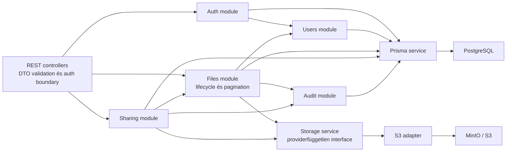
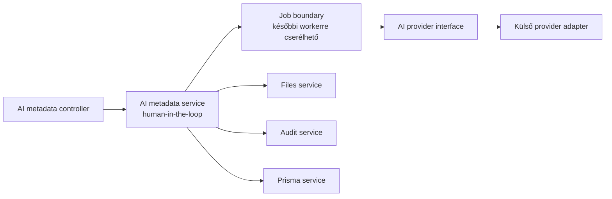

# C4 Component

## Státusz

**Tervezett állapot – nem implementált funkcionalitás.**

## Cél

A komponensnézet a későbbi NestJS API felelősségi határait rögzíti. A controllerek vékonyak, az üzleti szabályok service-ekben, a külső rendszerek pedig adapterek mögött maradnak.

## Core komponensek

## Opcionális MVP+ komponensek

Az MVP+ komponensek hiánya vagy hibája nem akadályozhat auth-, upload-, list-, preview-, download-, delete-, restore- vagy sharing-műveletet.

## Komponensfelelősségek

| Komponens | Felelősség | Fontos szerződés |
|---|---|---|
| `auth` | Regisztráció, login, logout, JWT-cookie és guard | Generic login hiba; token nem kerül localStorage-ba vagy logba |
| `users` | Profile, `usedStorageBytes`, `reservedStorageBytes` | Számlálók csak tranzakciós use case-ben változhatnak |
| `files` | Pending/active/deleted lifecycle, ownership, cursor pagination | Confirm pontosan egyszer könyvel; lista stabil rendezésű |
| `storage` | Presign, metadata, bounded range-read és delete interface | Direkt SDK-hívás nem szóródhat szét a codebase-ben |
| `sharing` | Token generálás, hash, expiry és publikus validáció | Core-ban nincs revoke/access analytics |
| `audit` | Fontos állapot- és security események | Nincs raw token, URL, fájltartalom vagy nyers MI-adat |
| `health` | Minimális API-elérhetőség | Nem szivárogtat secretet vagy részletes belső hibát |
| `config` | Környezeti változók validált leképezése | `process.env` használat nem szóródhat szét |
| `common` | Error shape, request ID, guard/decorator és pure validation utilok | Stabil, dokumentált API-hibák |
| `ai-metadata` | Opcionális suggestion lifecycle és emberi döntés | Csak aktív kép, explicit trigger, Core MVP-től független |

## Függőségi szabályok

- Controller nem hívhat közvetlenül Prisma vagy S3 klienst.
- A domain/service réteg portokat használ külső szolgáltatásokhoz.
- A cursor kódolja a rendezési kulcsot, de nem tartalmaz érzékeny adatot.
- A job boundary nem jelent elfogadott queue dependency-t; a kötelező thumbnailhez az ADR-016 egyszerű PostgreSQL-job workert tervez, az opcionális MI külön későbbi döntés.
- Audit események írása nem teheti közzé a művelethez használt credentialt vagy URL-t.

## Első thumbnail processing – tervezett komponensek, 2026-10-29

[ADR-016](adr/ADR-016-thumbnail-processing.md) és az [adatmodell](../03_design/data_model.md#első-thumbnail-processor--tervezett-szerződés-2026-10-29) a korábbi, csak opcionális MI-job határt kiegészíti a kötelező processing modullal:

| Komponens | Határ |
|---|---|
| Confirm + ProcessingJobService | Egy DB commitban aktivál és unique jobot ír; nincs szinkron decode |
| ProcessingWorker | DB poll/claim/lease/fence, tartós retry és recovery; nincs külön broker |
| ProcessorRegistry + ThumbnailProcessor | Verziózott manifest, tiszta bájt → output interfész; Sharp limitált gyermekben, SDK/DB nélkül |
| Derived lifecycle/accounting service | User→original→job→attempt lock-sorrend, pontosR reservation, egyszeri publication és proof-függő cleanup |
| Storage adapter | Teljes bounded conditional read és create-only backend write még hozzáadandó, providerhívás csak itt |
| Processing controller | Session/owner/origin, összevont státusz, thumbnail-url és külön retry; jelenleg nem létező végpontok |

A második image-metadata processor később ugyanazt a registry/interface/job határt használja, nem a thumbnailbe épül. A generálási lease nem cleanup-proof; terminális candidate cleanup saját attempt-zár és bizonyíték alapján megy.
