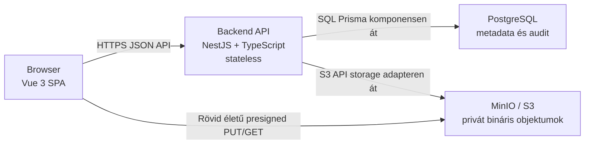

# C4 Container

## Státusz

**Tervezett állapot – nem implementált funkcionalitás.**

## Cél

A container nézet kizárólag a tervezett futtatható egységeket és adattárolókat mutatja. Prisma ORM, az S3 adapter és az opcionális MI adapter a Backend API belső komponensei, ezért ezen a szinten nem jelennek meg külön containerként.

## Diagram

## Containerek

| Container | Technológia | Felelősség | Scope |
|---|---|---|---|
| Browser SPA | Vue 3, Vite, TypeScript, Tailwind CSS | UI, protected route, upload orchestration, lapozás, user-friendly állapotok | Core MVP |
| Backend API | Node.js, NestJS, TypeScript | Auth, authorization, metadata, lifecycle, presign, usage, sharing, audit és hibamodell | Core MVP |
| PostgreSQL | PostgreSQL | User, FileObject, ShareLink, AuditEvent, számlálók és opcionális MI-javaslat | Core + MVP+ |
| Object storage | MinIO lokálisan; később S3-kompatibilis cloud | Privát kép- és videóobjektumok | Core MVP |

## Fő adatfolyamok

### Upload

1. A SPA metadata-kérést küld a Backend API-nak.
2. Az API tranzakcióban pending rekordot hoz létre és kvótát foglal.
3. Az API rövid életű presigned PUT URL-t ad.
4. A browser közvetlenül az object storage-ba tölt.
5. Confirmkor az API object metadata és bounded range-read alapján validál.
6. Siker esetén pontosan egyszer aktivál és könyvel usage-ot.

### Lista és olvasás

- A lista `createdAt + id` alapú cursor paginationt használ.
- Preview vagy download előtt az API ownershipet vagy share tokent ellenőriz.
- A bináris adatátvitel rövid életű URL-lel közvetlenül a browser és storage között történik.

### Opcionális MI

- Csak explicit felhasználói kérés és aktív kép esetén indul.
- A provider kiesése nem érinti a Core MVP containereinek működését.
- Később a feldolgozás külön workerbe mozgatható; queue/worker technológia még nincs kiválasztva.
- A külső MI-provider ezen a nézeten nem alkalmazáscontainer: a rendszerhatár a C4 Contextben, a provider adapter pedig a Component nézetben szerepel.

## Skálázási feltétel

A Backend API nem tárolhat tartós felhasználói vagy job állapotot folyamatmemóriában. Több API-példány ugyanazt a PostgreSQL és object storage állapotot használhatja; a session-affinitás nem lehet előfeltétel.

## Thumbnail worker-szerep – tervezett, 2026-10-29

Az [ADR-016](adr/ADR-016-thumbnail-processing.md) a kötelező thumbnailhez ugyanazon backend-kódból/image-ből futó külön worker folyamatot/Compose-szolgáltatást tervez, 512MiB/1CPU limittel és egy decode-gyermekkel. Ez a felső júliusi container-nézet kiegészítése; nem működő új container vagy elosztott platform. Adatút: API confirm → PostgreSQL tartós job; worker → PostgreSQL claim/fence/accounting; worker → storage adapter → eredeti bounded read/derived create-only write; külön gyermek → Sharp. A worker nem szolgál HTTP-t, a gyermeknek nincs hálózati/DB/storage credentialje. A bináris adat nem megy külső image-szolgáltatóhoz. A Redis/broker nélküli tervtől az opcionális MI-feldolgozás továbbra is független.
