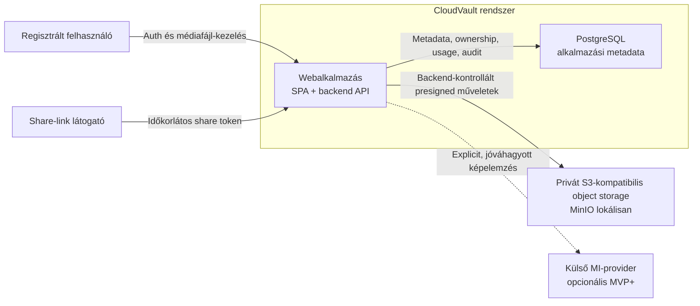

# C4 Context

## Státusz

**Tervezett állapot – nem implementált funkcionalitás.**

## Cél

A context nézet a CloudVault rendszerhatárát, felhasználóit és külső függőségeit mutatja. A PostgreSQL a rendszer belső adatrétege; az S3-kompatibilis object storage infrastruktúra-függőség. Az MI-provider kizárólag opcionális MVP+ integráció és külön adatvédelmi határ.

## Diagram

## Szereplők és határok

- A regisztrált felhasználó a Vue SPA-n keresztül kezeli saját fájljait.
- A share-link látogató kizárólag érvényes, nem lejárt token alapján kaphat rövid életű read URL-t.
- A CloudVault backend ellenőrzi az authenticationt, ownershipet, fájlállapotot, kvótát és share-linket.
- A browser nem kap tartós storage credentialt; a presigned URL csak rövid ideig és szűk műveletre érvényes.
- A külső MI-providerhez csak aktív kép, explicit felhasználói kérés és dokumentált privacy feltételek mellett kerülhet adat.

## Hatókör

Core MVP: auth, upload, lapozott lista, preview/download, usage, sharing, soft delete/restore és alap audit.

MVP+: opcionális MI-metaadat-javaslat.

Later: cloud deployment, multipart upload, automatizált purge worker, integration/e2e tesztek és CI/CD.
