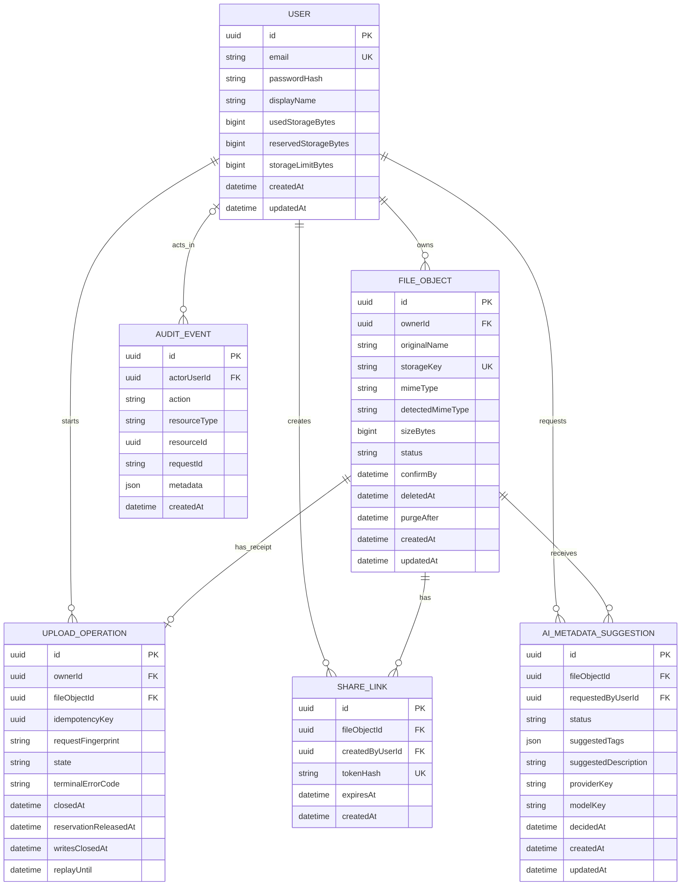
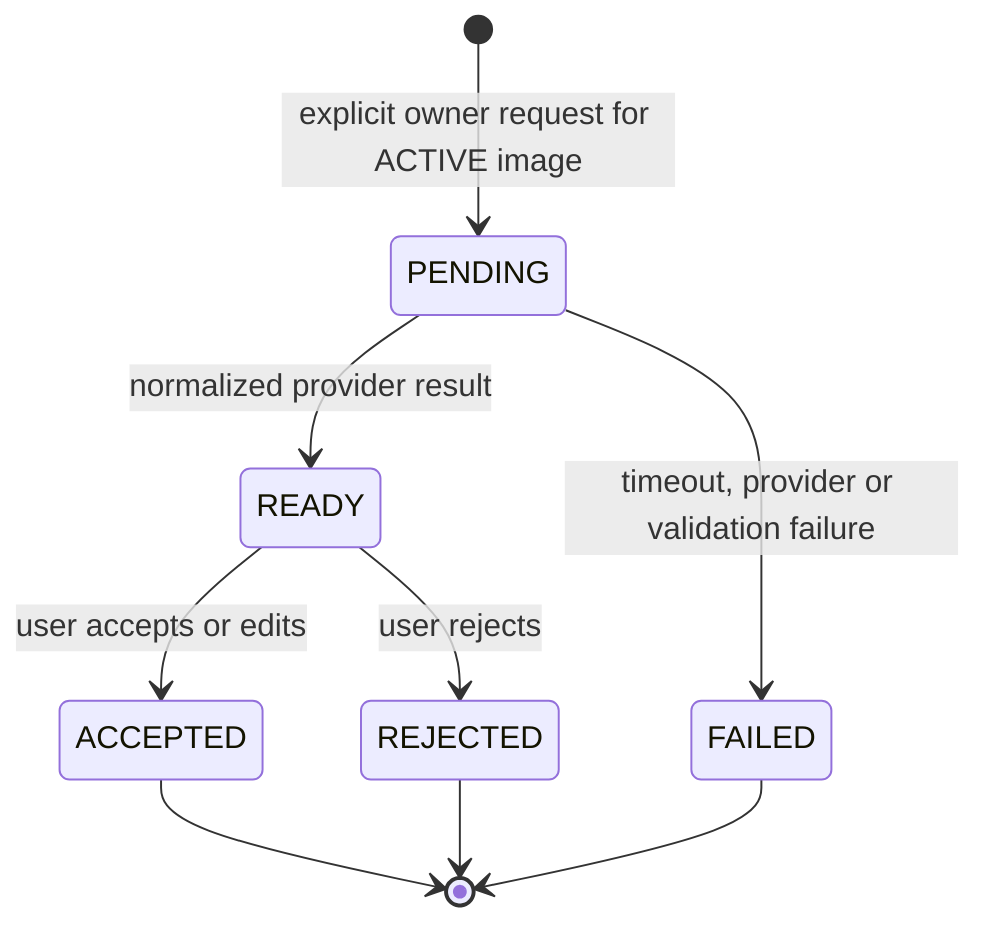

# Adatmodell

**A Core adatbázis, az első upload UploadOperation és a processor job/attempt/result sémája/migrációja implementált; az init és confirm implementált, a cleanup fizikai release-ága íráslezárási bizonyítékra vár.**

A kezdeti [Prisma-séma](../../backend/prisma/schema.prisma) és [SQL migráció](../../backend/prisma/migrations/20261018000100_initial_core/migration.sql) létrehozza a `User`, `FileObject`, `ShareLink`, `AuditEvent` modelleket. Az auth API már implementált; a séma önmagában nem jelent működő upload/sharing/lifecycle API-t. Az alábbi táblák az alapmezők mellett későbbi mezőket és opcionális MI-t is terveznek; az implementált határ az alábbi külön szakaszban szerepel. A migráció tényleges futtatási eredménye a [tesztriport](../04_quality/test_report.md) része.

## A kezdeti migráció implementált határa

- `User`: a Core mezők, unique email és explicit `storageLimitBytes`; nincs előre beégetett felhasználói tárhelycsomag. A regisztráció trim+lowercase ASCII emailt ment és a validált `DEFAULT_USER_STORAGE_LIMIT_BYTES` szerverkonfigurációból ad kezdőkvótát (default 1073741824 bájt); used/reserved nulla a DB defaultokkal. Ez nem csomagkezelés. A séma/migráció nem változott.
- `FileObject`: a Core mezők és cleanup retry mezők; `FileStatus = PENDING_UPLOAD | ACTIVE | SOFT_DELETED`, `FileVisibility = PRIVATE`. A későbbi checksum, MI-tags/description és purge-állapotok nincsenek a sémában.
- `ShareLink`: id, file/creator, SHA-256 `tokenHash`, expiresAt, createdAt; revoke/access limit/analytics nincs implementálva. A fájl `(id, ownerId)` unique kulcsára mutató `(fileObjectId, createdByUserId)` FK tiltja az eltérő tulajdonosú létrehozót; a share API később ellenőriz aktív állapotot is.
- `AuditEvent`: Core mezők, nullable actor, JSONB metadata és indexek; az auditírás és metadata-allowlist service még nem implementált.
- Időmezők `timestamptz(3)`, bájtszámlálók PostgreSQL BIGINT. A 100 MB-ként hivatkozott korlát itt pontosan 104857600 bájt (100 MiB).
- A migráció SQL CHECK-jei a Prisma deklaráción túl védik a kvótát/számlálókat, fájlméretet, cleanup-számlálót, alap állapot/idő konzisztenciát és a share hash/lejárat alakját. Ezeket új migráció készítésekor meg kell őrizni; a Prisma nem írja le őket a schema DSL-ben.
- User→file/share törlés `Restrict`; file→share törlés `Cascade`; audit actor törlés `SetNull`. Ez FK-védelem, nem megvalósított account-delete vagy purge termékfunkció.
- `AiMetadataSuggestion`, import/session, processing job és derived result táblák nincsenek a kezdeti migrációban; a processor modelleket a külön 20261029000100 migráció adja hozzá. A folytatható importhoz a [terv](../plan.md) szerint még külön szerződésfrissítés kell.

## Első képfeltöltés adatmodell-szerződése – 2026-10-23

Az [API Upload szerződését](api.md#upload--első-képfeltöltési-szelet-tervezett) kiszolgáló **implementált séma**, [új SQL-migrációval](../../backend/prisma/migrations/20261023000100_upload_operations/migration.sql). A kezdeti migráció változatlan maradt; az alábbi `UploadOperation` entitás és enumok létrejöttek. Az init új fájl/receipt/foglalás tranzakciója és replay-je implementált; a confirm és az őrzött cleanup is implementált; tényleges íráslezárási proof és receipt-karbantartás továbbra sincs. Ez az egyképes single-PUT baseline adatmodellje; nem import/session-, processor/job- vagy derived-object modell.

### Fájl és feltöltési művelet szétválasztása

A `FileObject.status` megmarad `PENDING_UPLOAD`, `ACTIVE`, `SOFT_DELETED` értékeken. A végleg hibás, lejárt vagy már kitakarított, de dedupe miatt még őrzött fájlrekord is `PENDING_UPLOAD`: ettől **nem aktiválható és nem feltétlenül foglal bájtokat**. A megerősíthetőséget és az élő foglalást az `UploadOperation` állapota dönti el. A lista/preview/download/sharing továbbra is csak a megfelelő `FileObject` életciklus alapján engedélyezhető; a pending receipt nem médiaelem.

Egy új init pontosan egy `FileObject` és egy `UploadOperation` rekordot hoz létre ugyanabban a tranzakcióban. Egy fájlnak legfeljebb egy ilyen művelete van; új, tudatos feltöltési kísérlet új init-kulcsot **és új fileId/storageKey-t** kap. Nem írjuk felül ugyanazon művelet payloadját. Régebbi/sikeres fájlnál a megőrzési ablak után a műveletrekord már hiányozhat; `ACTIVE` confirm ilyenkor is 200 no-op.

### `UploadOperation` – implementált séma

| Mező | Típus / korlát | Jelentés |
|---|---|---|
| `id` | UUID PK | Belső műveletazonosító; nem külön API-resource. |
| `ownerId` | UUID FK → User, NOT NULL | Az authból származó tulajdonos; account delete `Restrict`. |
| `fileObjectId` | UUID, NOT NULL, unique | Hivatkozás a fájlra; `(fileObjectId, ownerId)` FK → `FileObject(id, ownerId)`, `Restrict`. Más owner fájlja nem kapcsolható hozzá. |
| `idempotencyKey` | UUIDv4, NOT NULL | Az API `Idempotency-Key` értéke; unique `(ownerId, idempotencyKey)`. A tábla kizárólag upload-init műveletet jelent, ezért nincs általános művelettípus/queue. |
| `requestFingerprint` | verziózott string, `v1:` + 64 lowercase hex | A normalizált init-payload SHA-256 lenyomata; nem fájlchecksum és nem auth-secret. Sikeres init után nem módosítható. |
| `state` | `OPEN`, `FINALIZED`, `REJECTED`, `EXPIRED` | Alább definiált belső feltöltési állapot; nem új `FileStatus`. |
| `terminalErrorCode` | nullable allowlistelt enum/string | `REJECTED`: `FILE_TOO_LARGE` vagy `UPLOAD_VALIDATION_FAILED`; `EXPIRED`: `UPLOAD_EXPIRED`; egyébként null. HTTP-kódot ebből vezetjük le, nem tárolunk külön, elcsúszható státuszt. |
| `closedAt` | nullable timestamptz(3) | OPEN esetén null; az első sikeres/hibás/lejárati lezárás ideje, utána változatlan. |
| `reservationReleasedAt` | nullable timestamptz(3) | Csak REJECTED/EXPIRED esetén lehet kitöltve; a sikertelen upload foglalásának egyszeri feloldási ideje. FINALIZED esetén a foglalás nem felszabadult, hanem used-ba került. |
| `writesClosedAt` | nullable timestamptz(3) | Szerver által rögzített storage-bizonyíték ideje: minden kiadott PUT-jog és függő írás lezárt, új/késői objektum már nem keletkezhet. Nem azonos az URL lejáratával, nem időzítőből automatikusan beállított flag. |
| `replayUntil` | timestamptz(3), NOT NULL | Az első sikeres init rögzített ideje + 24 óra; változatlan minimális receipt-megőrzés, nem upload-határidő. |
| `createdAt`, `updatedAt` | timestamptz(3), NOT NULL | Létrehozás és utolsó módosítás. `createdAt` az első init `t0` ideje, nem minden replayé. |

A deklarált méret, normalizált név/MIME, belső kulcs, `uploadUrlExpiresAt`, `confirmBy` és cleanup retry metadata **egy helyen**, a hozzákapcsolt `FileObject` rekordban marad. Az eredeti méret és az upload határidői a feltöltési művelet alatt változatlanok. Raw URL, token, credential, provider-válasz vagy fájlbyte nem kerül a receiptbe. A cleanup operációs hibája (`cleanupLastErrorCode`) nem írhatja felül a kliensnek megőrzött terminális hibát.

A fingerprint képzése: a már validált és normalizált `(originalName, mimeType, sizeBytes)` értékekből a `['image-upload-init', 1, originalName, mimeType, sizeBytes tízes számrendszerű stringként]` tömb Node.js `JSON.stringify` szerinti tömör, UTF-8 JSON-serializációjának SHA-256-a, `v1:` előtaggal. A stringek JSON-escape szabályai rögzítettek, nincs kulcsrendezési vagy whitespace-eltérés; az egészméret-stringben nincs előjel/vezető nulla. A normalizálás az API-é: trim+NFC név, pontos allowlistelt MIME, egész bájtméret. Nem böngészőoldali hash és nem tartalom szerinti deduplikáció. A fingerprint verziója nem változtatható meg meglévő receipt újraértelmezésével.

### Állapotok és tartós könyvelési jelentés

| Műveletállapot | FileObject állapot | Foglalás / used | Válasz és engedett továbblépés |
|---|---|---|---|
| `OPEN` | PENDING_UPLOAD | A deklarált méret reserved, release-idő null. | `now < confirmBy` esetén verifikálható. Hiányzó objektum 409, átmeneti providerhiba 503: OPEN marad. A határ után már akkor sem aktiválható, ha a sweeper még nem jelölte EXPIRED-re. |
| `FINALIZED` | ACTIVE, később SOFT_DELETED | Ugyanannyi reserved egyszer used-ba került; release-idő null. | Aktív confirm 200 no-op, törölt fájl confirmja 409; nincs visszaút OPEN-be vagy pending cleanup. |
| `REJECTED`, release-idő null | PENDING_UPLOAD | Reserved megmarad, used nem nő. | Stabil eredeti 413/422; csak biztonságos cleanup/retry lehetséges. |
| `EXPIRED`, release-idő null | PENDING_UPLOAD | Reserved megmarad, used nem nő. | Stabil 410; nincs új URL, aktiválás vagy ugyanazon-kulcsos új init. |
| `REJECTED` / `EXPIRED`, release-idő kitöltve | PENDING_UPLOAD receipt | Nincs foglalás, used nem nőtt. | Terminális replay változatlan, metadata-megőrzés a határig; utána a sikertelen fájl és receipt együtt törölhető. |

**Átmenetek:** OPEN → FINALIZED / REJECTED / EXPIRED, mindhárom egyszeri és végleges. Az első terminális ok megmarad; egy korábbi 413/422 nem válik a későbbi határidőtől 410-é. A cleanup sikere nem új enumérték: az eredeti REJECTED/EXPIRED mellé kerül egyszer `reservationReleasedAt`. Nem vezetünk be `CLEANING`/lease/worker-queue modellt: terminális műveleten több idempotens delete-próba is futhat, de a DB-feloldást csak az első végezheti. A biztonságot az állapot és a storage-kapuk adják, nem az a feltételezés, hogy mindig csak egy worker van.

### Tranzakciók és versengő kérések

Az összes érintett user/fájl/művelet-írás azonos zárolási sorrendet követjen: **User → FileObject → UploadOperation**. Initkor a user zárolása után kereshető a tulajdonos dedupe-kulcsa; a user-szintű szerializálás megakadályozza az azonos owner két initjének és számlálóváltozásainak versenyét. Az init Prisma-tranzakciójának paraméterezett SELECT FOR UPDATE zárolása implementált; a confirm és cleanup is ezt a sorrendet alkalmazza. Puszta előzetes SELECT nem helyettesíti az atomikus tranzakciót. Storage I/O alatt nem tartunk DB-zárat.

1. **Új init:** validáció/fingerprint és a még ki nem adott presign előkészítése után a tranzakció a user zárolásával ellenőrzi a dedupe-kulcsot. Ha nincs receipt, ellenőrzi `used + reserved + size <= limit`, és együtt menti a pending fájlt, OPEN műveletet, fix határidőket, `replayUntil` értéket és a reserved-növelést. Sikeres commit előtt PUT-jog nem adható ki. Rollback esetén egyik sem marad; elutasított, nem commitolt kérés kulcsa nem foglalt. Bizonytalan commitnál ugyanaz a kulcs oldja fel az eredményt.
2. **Init replay:** a megőrzött saját receipt fingerprint-eltérése 409 IDEMPOTENCY_CONFLICT, változtatás nélkül. Egyezésnél ugyanaz a fileId, payload-azonosság és foglalás; nincs új határidő vagy t0. OPEN és élő URL esetén legfeljebb az eredeti abszolút lejáratig újraaláírható; lejárt URL mellett csak `upload: null`. Terminális receiptből stabil eredmény/hiba jön; FINALIZED esetén az aktuális fájl állapota dönt (ACTIVE 200, SOFT_DELETED 409). Más owner kulcsa külön névtér, nem szivárog ki.
3. **Confirm siker:** storage-verifikáció a tranzakción kívül, változatlan objektumazonossággal; a végső tranzakció user/fájl/művelet zárolás után újra ellenőrzi az OPEN állapotot, a pending fájlt, a változatlan méretet és `now < confirmBy` feltételt. Egy commit állítja ACTIVE/FINALIZED-ra, menti a detektált MIME-ot és closedAt-ot, ugyanannyi reservedet von le és used-ot ad hozzá. A vesztes konkurens confirm újraolvassa az aktuális állapotot; nem könyvel még egyszer. Az ACTIVE no-ophoz nem kell élő receipt vagy régi confirm-határidő.
4. **Hibás/lejárt lezárás:** a végső tranzakció csak OPEN-t zárhat REJECTED/EXPIRED-re, stabil kóddal és closedAt-tal. Confirm és cleanup közül amelyik előbb lezár, meghatározza az eredményt; FINALIZED művelethez nincs pending object delete. A határidő után OPEN-re érkező confirm/sweeper először tartósan EXPIRED-re zár. Ha a tartalomhiba rögzítésekor már lejárt a még OPEN művelet, EXPIRED a helyes eredmény; a már korábban rögzített REJECTED okot ez nem változtatja meg. Ebben a lezárási tranzakcióban még nincs bájtfeloldás.
5. **Cleanup:** csak REJECTED/EXPIRED jelölt; a backend előbb igazolja a korábbi PUT-ok végleges lezárását (`writesClosedAt`), majd az objektum biztos hiányát/sikeres törlését. Sikertelen vagy bizonytalan provider-művelet után a foglalás és retry metadata megmarad. A release-tranzakció újból ellenőrzi a terminális állapotot, a writesClosedAt-ot és a null release-időt; pontosan egyszer vonja le a deklarált méretet a reservedből, és ugyanakkor tölti ki a release-időt. A fájl/receipt még nem törlődik. Második cleanup a kitöltött jelzőnél no-op; crash a storage-delete után újabb absence/delete ellenőrzéssel befejezhető.

Az ellenőrzött object identity és a tényleges méretkikényszerítés továbbra is storage-adapter bizonyítási kapu. A `writesClosedAt` **nem megoldása** a későn befutó PUT problémájának: csak egy később igazolt backend/storage-tény tartós rögzítése. URL-lejáratból vagy pillanatnyi 404-ből nem állítható be. Ha a kiválasztott providerrel nem bizonyítható, az adott foglalás nem oldható fel és az adatút nem tekinthető késznek. Nem választunk most új protokollt, queue-t vagy storage-dependencyt.

### Számlálók és számpélda

- Az első szelet minden élő foglalása egy PENDING_UPLOAD fájlhoz és olyan művelethez tartozik, amely nem FINALIZED és release-ideje null. A reserved érték ezek deklarált méreteinek összegével konzisztens; ez **invariáns/ellenőrzési összeg**, nem minden dashboard-kérésnél futó SUM.
- Used csak az aktiváláskor nő, soft delete/restore nem változtatja; sikertelen init/confirm vagy pending cleanup nem növeli.
- `closedAt`, lejárat vagy REJECTED önmagában nem enged reserved-levonást. A release-jelző és számláló együtt commitol. A PENDING_UPLOAD sor puszta jelenléte sem jelenti, hogy már kitakarított receipt még bájtokat foglal.

Példa: `limit=1000`, `used=200`, `reserved=100`, új kép 300 bájt → init után `(used,reserved)=(200,400)`. Azonos init replay után változatlan. Sikeres confirm → `(500,100)`; ismételt confirm változatlan. A korábbi 100 bájtos másik pending elutasítása és egy cleanup-hiba mellett továbbra is `(500,100)`. Bizonyított végleges cleanup/release után `(500,0)`, ismételt release változatlan. Sikertelen foglalás vagy rollback egyik lépésben sem növeli a számlálót.

### Megőrzés, törlés, indexek és sémahatár

- A receipt legalább `replayUntil`-ig él, és ezen túl is, amíg OPEN, `writesClosedAt` null, vagy egy REJECTED/EXPIRED művelet release-ideje null. A `replayUntil` nem automatikus törlési idő: lejárt, de le nem zárt OPEN előbb EXPIRED-re és biztonságos cleanupra kerül.
- A receipt-karbantartó sikeres FINALIZED műveletnél is kérheti a storage-adapter íráslezárási bizonyítékát, és a User→FileObject→UploadOperation zárolási rendben idempotensen rögzítheti a writesClosedAt-ot. Ez nem töröl aktív objektumot és nem változtat számlálót. A bizonyíték rögzítése minden esetben az érintett, változatlan file/storageKey-hez kötött; a closedAt és a terminális hibakód ilyenkor is változatlan.
- Törlés feltétele: `now >= replayUntil`, bizonyított writesClosedAt és FINALIZED vagy már released terminális állapot. A pruner ugyanabban a user/fájl/művelet zárolási rendben újból ellenőrzi a feltételeket. Sikeres fájlnál csak a műveletrekord törlődik, FileObject és used megmarad. Sikertelennél a művelet és a hozzá tartozó pending metadata együtt törölhető, mert nincs objektum/foglalás; a fájlt védő Restrict FK előtt a receipt törlése történik. Ez nem aktív fájl retention-purge implementáció.
- Receipt törléséig init replay és saját terminális confirm stabil 410/413/422-t kap. A sikertelen fájl és receipt szabályos törlése után confirm 404; ugyanazon régi init-kulcsra a garantált megőrzésen túl nincs dedupe-garancia. A kliens régi kulcsot nem használhat új kísérlethez. Aktív fájl confirmja a receipt törlése után is 200 no-op.
- Kötelező unique `(ownerId, idempotencyKey)` és `fileObjectId`; composite owner/file FK; index `UploadOperation(state, replayUntil)` a megőrzéshez, `UploadOperation(state, reservationReleasedAt)` a cleanuphoz, valamint a meglévő `FileObject(status, confirmBy)` és retry-idő szerinti cleanup-kiválasztás. A migráció ezeket létrehozza, a retry-kiválasztáshoz `FileObject(status, cleanupRetryAfter)` indexszel. A Prisma összetett one-to-one relációja külön unique `(fileObjectId, ownerId)` indexet is igényel a már egyedi `fileObjectId` mellett; ez ORM-megkötés, nem új termékszabály. Nincs általános queue-indexcsomag.
- Azonos táblán belüli CHECK-ek: OPEN ↔ closedAt/error/release null; FINALIZED → closedAt kitöltött, error/release null; REJECTED/EXPIRED → megfelelő allowlistelt ok és closedAt; kitöltött release → terminális hibás állapot, writesClosedAt kitöltött, release ideje nem korábbi egyik bizonyítékánál; replayUntil legalább createdAt+24 óra. A fingerprint alakja és az azonosítók is korlátozottak. A cross-row FileObject-állapot és User-összeg összhangját nem állítjuk egyszerű SQL CHECK-kel garantáltnak: a tranzakciós service, zárolási rend és külön tesztek felelőssége.
- Az új migráció megőrzi a jelenlegi SQL-kvóta-, bájt-, életciklus- és share-owner constraint-eket. A migráció a User → FileObject írásblokkoló zárolása után ellenőrzi a meglévő PENDING_UPLOAD sorokat és a nem nulla reserved számlálókat: receipt nélküli korábbi pendinghez nem található ki kliens-idempotenciakulcs, és foglalás nem engedhető el automatikusan. Ha bármelyik előfordul, a migráció egyetlen tranzakcióját visszagörgetve megáll és külön egyeztetett rendezés szükséges; nincs volume-reset vagy feltételezett üres adatbázis.

A SQL CHECK-ek NULL-biztos állapot/hibakód/release párokat, UUIDv4-et, fingerprint-alakot, legalább 24 órás receiptet, véges időpontokat és időrendet védenek. Nem garantálják a rekordok közötti állapot-/számlálóegyezést, az immutabilitást vagy az átmenetek sorrendjét; ez továbbra is a következő service és tesztjeinek feladata. A nullable `writesClosedAt` mezőt a migráció nem tölti ki, és nem bizonyít storage-íráslezárást.

**Nyitott kapu:** a cleanup/release előtti storage-íráslezárási bizonyíték. A confirm másik feltétele, az immutable create-only objektum és HEAD/range egyezése implementált és külön ellenőrzött; a confirmnak nem kell az összes régi PUT befejeződését feltételeznie, amíg nem törli az objektumot. Import-/transfer-session, processor/job/result, thumbnail és derived quota továbbra is másik szerződésfeladat.

## Modellezési határ

- A bináris kép- és videotartalom privát MinIO/S3 object storage-ban él.
- PostgreSQL az identity, ownership, fájlállapot, kvóta, share link, audit és opcionális MI-javaslat metaadatát tárolja.
- A tárolási kulcs belső adat; API-válaszban nem jelenik meg.
- Minden bájtszámláló nem negatív `BigInt`, minden időpont UTC.
- A kezdeti `Core MVP` entitásai: `User`, `FileObject`, `ShareLink`, `AuditEvent`; az első uploadhoz a fent részletezett `UploadOperation` implementált kiegészítés.
- Az `AiMetadataSuggestion` kizárólag `MVP+`; hiánya nem akadályozhat core migrációt vagy működést.

## ERD



Az ERD az olvashatóság kedvéért nem mutat minden nullable, cleanup- és `Later` mezőt; az UPLOAD_OPERATION teljes egészében tervezett, az AI_METADATA_SUGGESTION pedig opcionális MVP+; az alábbi táblák a teljes tervezett szerződést adják.

## Entitások

### `User`

| Mező | Típus és korlát | Fázis | Jelentés |
|---|---|---|---|
| `id` | UUID, PK | Core MVP | Átlátszatlan felhasználó-azonosító |
| `email` | normalizált string, unique | Core MVP | Bejelentkezési azonosító; válaszokban csak a saját user kapja |
| `passwordHash` | string | Core MVP | [ADR-014](../02_architecture/adr/ADR-014-password-hashing.md) szerinti verziózott scrypt rekord (182 karakter, varchar(255)); soha nem kerül API-ba, logba vagy audit metadata-ba. A hash service nem tárol; a regisztrációs AuthService menti a hash-t, és explicit select/projekcióval kizárja az API-ból. |
| `displayName` | validált string | Core MVP | Megjelenítési név |
| `usedStorageBytes` | BigInt, default 0, `>= 0` | Core MVP | Aktivált és fizikailag még létező objektumok denormalizált mérete |
| `reservedStorageBytes` | BigInt, default 0, `>= 0` | Core MVP | Még used-ba át nem vitt és biztonságosan fel nem oldott upload-foglalások deklarált mérete |
| `storageLimitBytes` | BigInt, `> 0` | Core MVP | Felhasználói kvóta |
| `createdAt` | timestamp | Core MVP | Létrehozás |
| `updatedAt` | timestamp | Core MVP | Utolsó módosítás |

Kötelező invariáns:

```text
0 <= usedStorageBytes
0 <= reservedStorageBytes
usedStorageBytes + reservedStorageBytes <= storageLimitBytes
```

Az utolsó feltételt az upload init tranzakciójának versengő kéréseknél is garantálnia kell.

### `FileObject`

| Mező | Típus és korlát | Fázis | Jelentés |
|---|---|---|---|
| `id` | UUID, PK | Core MVP | Fájlmetaadat azonosító |
| `ownerId` | UUID, FK → User | Core MVP | Tulajdonos és authorization határ |
| `originalName` | validált string | Core MVP | Kizárólag display/download név; az első UI a felismert formátumhoz igazított nevet küldi (például JPEG-tartalmú kep.png → kep.jpg); storage key nem ebből képződik |
| `storageKey` | string, unique | Core MVP | Backend által generált belső object key |
| `mimeType` | string | Core MVP | Kliens által deklarált, initkor allowlistelt MIME |
| `detectedMimeType` | nullable string | Core MVP | Confirmkor magic numberből detektált MIME |
| `sizeBytes` | BigInt, `> 0`, max. 100 MB | Core MVP | Initkor deklarált, confirmkor `HEAD` alapján igazolandó méret |
| `checksum` | nullable string | Later | Csak külön end-to-end checksum döntéssel; S3 ETag önmagában nem igazolás |
| `visibility` | enum, default `PRIVATE` | Core MVP | A bucket és a fájl privát; share link nem változtat tulajdonjogot |
| `status` | FileStatus | Core/Later | Fájl-életciklus |
| `uploadUrlExpiresAt` | timestamp | Core MVP | A kiadott PUT URL tervezett, alapértelmezetten 5 perces lejárata |
| `confirmBy` | timestamp | Core MVP | Init után 15 perc: 5 perces upload URL és további 10 perces confirm-grace vége |
| `cleanupRetryAfter` | nullable timestamp | Core MVP | Invalid/abandoned cleanup következő lehetséges próbája |
| `cleanupAttemptCount` | integer, default 0 | Core MVP | Operációs retry-számláló; 60s-ról induló duplázódó backoff, maximum 1h |
| `cleanupLastErrorCode` | nullable string | Core MVP | Biztonságos, belső hibakategória, providerüzenet vagy URL nélkül |
| `deletedAt` | nullable timestamp | Core MVP | Soft delete időpontja |
| `purgeAfter` | nullable timestamp | Core MVP | Restore-jogosultság vége, `deletedAt + 30 nap` |
| `tags` | string lista, default üres | MVP+ | Ember által elfogadott/szerkesztett kanonikus címkék |
| `description` | nullable string | MVP+ | Ember által elfogadott/szerkesztett kanonikus leírás |
| `createdAt` | timestamp | Core MVP | Létrehozás |
| `updatedAt` | timestamp | Core MVP | Utolsó módosítás |

Tervezett `FileStatus`:

- `PENDING_UPLOAD`: nem aktivált fájl, nem listázható aktívként; az élő vagy már feloldott foglalást és az aktiválhatóságot az UploadOperation határozza meg.
- `ACTIVE`: `HEAD` és bounded range magic-number validáció után aktivált fájl.
- `SOFT_DELETED`: normál listából rejtett, retention alatt visszaállítható vagy lejárat után purge-ra váró fájl.
- `PURGE_FAILED`: `Later` állapot, ha a retention purge object delete lépése hibázott.
- `PURGED`: nem kötelezően perzisztált rekordállapot, hanem terminális audit/domain esemény; a későbbi stratégia a rekord törlését vagy minimális tombstone-ját választhatja.

Invalid és abandoned upload cleanup-hibánál a fájl `PENDING_UPLOAD` marad, élő foglalással és retry metadata-val; a terminális REJECTED/EXPIRED ok külön, az UploadOperationben van. Sikeres release után a pending metadata a receipt-megőrzés végéig megmaradhat, már foglalás nélkül. Új FileStatus vagy queue nincs; a művelet-enum a fent részletezett implementált séma része.

### `ShareLink`

| Mező | Típus és korlát | Fázis | Jelentés |
|---|---|---|---|
| `id` | UUID, PK | Core MVP | Megosztás azonosító |
| `fileObjectId` | UUID, FK → FileObject | Core MVP | Csak aktív fájlhoz hozható létre |
| `tokenHash` | SHA-256 string, unique | Core MVP | A 32 random byte base64url token egyirányú lenyomata; raw token nem tárolható |
| `createdByUserId` | UUID, FK → User | Core MVP | A létrehozó owner |
| `expiresAt` | timestamp | Core MVP | Kötelező lejárat, létrehozástól 1 óra–7 nap |
| `createdAt` | timestamp | Core MVP | Létrehozás |
| `revokedAt` | nullable timestamp | Later | Visszavonás |
| `maxAccessCount` | nullable integer | Later | Opcionális hozzáférési limit |
| `accessCount` | integer, default 0 | Later | Analitikai/limit számláló |

A raw token 32 kriptográfiailag véletlen bájt base64url kódolása, és csak a létrehozási válaszban jelenhet meg. A `tokenHash` ennek SHA-256 hash-e. Az `expiresAt` a létrehozástól számított minimum 1 óra és maximum 7 nap.

Soft delete-kor a fájl összes meglévő `ShareLink` rekordja ugyanabban a tranzakcióban törlődik. Restore nem rekonstruálja ezeket; új megosztáshoz új token szükséges. Ez belső lifecycle-szabály, nem általános felhasználói revoke API.

### `AuditEvent`

| Mező | Típus és korlát | Fázis | Jelentés |
|---|---|---|---|
| `id` | UUID, PK | Core MVP | Append-only eseményazonosító |
| `actorUserId` | nullable UUID, FK → User | Core MVP | Authenticated actor; publikus share eseménynél lehet null |
| `action` | stabil enum/string | Core MVP | Például login outcome, upload init/confirm, delete, restore, share create/validate |
| `resourceType` | string | Core MVP | Erőforrás-kategória |
| `resourceId` | nullable UUID | Core MVP | Átlátszatlan resource referencia |
| `requestId` | string | Core MVP | Kéréskorreláció |
| `metadata` | JSON, allowlistelt kulcsok | Core MVP | Csak nem érzékeny státusz- és hibakategória |
| `createdAt` | timestamp | Core MVP | Eseményidő |

Audit metadata nem tartalmazhat jelszót, password hash-t, JWT-t, raw share tokent, presigned URL-t, storage credentialt, fájltartalmat vagy nyers MI input/outputot. Audit UI nem Core MVP.

### `AiMetadataSuggestion`

| Mező | Típus és korlát | Fázis | Jelentés |
|---|---|---|---|
| `id` | UUID, PK | MVP+ | Javaslat azonosító |
| `fileObjectId` | UUID, FK → FileObject | MVP+ | Csak owner `ACTIVE` képéhez |
| `requestedByUserId` | UUID, FK → User | MVP+ | Explicit indító felhasználó |
| `status` | AiSuggestionStatus | MVP+ | Human-in-the-loop életciklus |
| `suggestedTags` | string lista/JSON | MVP+ | Provider normalizált címkejavaslata |
| `suggestedDescription` | nullable string | MVP+ | Provider normalizált leírásjavaslata |
| `acceptedTags` | nullable string lista/JSON | MVP+ | Változatlan vagy szerkesztett elfogadott érték |
| `acceptedDescription` | nullable string | MVP+ | Változatlan vagy szerkesztett elfogadott érték |
| `providerKey` | string | MVP+ | Minimális provenance; nem credential |
| `modelKey` | nullable string | MVP+ | Dokumentált modell/verzió referencia |
| `failureCode` | nullable string | MVP+ | Biztonságos, normalizált hibakategória, raw válasz nélkül |
| `decidedAt` | nullable timestamp | MVP+ | Accept/reject időpont |
| `createdAt` | timestamp | MVP+ | Kérés időpontja |
| `updatedAt` | timestamp | MVP+ | Utolsó állapotváltozás |

`AiSuggestionStatus`: `PENDING`, `READY`, `ACCEPTED`, `REJECTED`, `FAILED`.

Raw kép, presigned URL és nyers provider-válasz nem tárolható e rekordban. Provider retention, régió és licenc külön privacy go/no-go feltétel.

## FileObject állapotgép


Fontos különbség: a 30 napos `purgeAfter` a restore-jogosultság vége, nem garantált fizikai törlési SLA. Az automatizált retention purge `Later`, míg a soha nem aktivált pending/abandoned upload cleanup `Core MVP`.

## MI-javaslat állapotgép



Retry új, explicit javaslatkérést hoz létre; korábbi `FAILED` vagy `REJECTED` rekord nem alkalmazható automatikusan.

## Tranzakciós invariánsok

### Upload init, confirm és cleanup

A részletes első szelet állapotmátrixa és zárolási rendje az [upload-adatmodellben](#első-képfeltöltés-adatmodell-szerződése--2026-10-23) szerepel. Összefoglalva:

- Init: a sikeres dedupe-kulcs, FileObject, OPEN UploadOperation és reserved-növelés egy tranzakció. Egyező replay nem foglal újra; eltérő fingerprint stabil 409.
- Confirm: változatlan objektum storage-validációja után csak OPEN + pending + határidőn belüli feltételes átmenet könyvelhet egyszer; FileObject ACTIVE, művelet FINALIZED, reserved→used és a korábban tervezett minimális siker-audit egy commitban. A no-op nem hoz új auditot/számlálót.
- Invalid/expiry: először tartós REJECTED/EXPIRED lezárás, könyvelés nélkül. Puszta PENDING_UPLOAD státusz nem ad aktiválási jogot.
- Cleanup: lezárt művelet, bizonyított writesClosedAt és object absence/delete után a reserved-levonás és reservationReleasedAt egy tranzakció. Bizonytalanságnál/retry-nál sem jelző, sem számláló nem változhat sikeres release-re. A receipt később, saját megőrzési szabályával törlődik.
- Külső storage-művelet és SQL-tranzakció nem atomikus együtt; részhiba/újraindítás a tárolt állapotból folytatható. A konkrét worker/purge implementáció továbbra is külön feladat.

### Soft delete és restore

- `ACTIVE → SOFT_DELETED`: `deletedAt = now`, `purgeAfter = now + 30 nap`.
- Ugyanebben a tranzakcióban a fájl összes meglévő ShareLink rekordja törlődik.
- `SOFT_DELETED → ACTIVE`: csak `now < purgeAfter`; a két időmező törlődik.
- Egyik átmenet sem változtatja a used vagy reserved számlálót.
- Soft-deleted fájlhoz share read URL nem adható; restore korábbi linket nem éleszt újra.

### Later purge

Csak igazolt, idempotens object delete után csökkenthető `usedStorageBytes`. Storage-hiba `PURGE_FAILED` állapotot hagy; a konkrét worker/queue és tombstone stratégia külön későbbi döntés.

## Indexek és constraint-ek

Tervezett minimum:

- unique `User.email`;
- unique `FileObject.storageKey`;
- összetett index `FileObject(ownerId, status, createdAt, id)` a cursor-listákhoz;
- index `FileObject(status, confirmBy)` a pending cleanup kiválasztásához;
- index `FileObject(status, purgeAfter)` a későbbi retention purge kiválasztásához;
- unique `ShareLink.tokenHash` és index `ShareLink(expiresAt)`;
- index `AuditEvent(createdAt)`, valamint szükség szerint `resourceType + resourceId`;
- index `AiMetadataSuggestion(fileObjectId, status, createdAt)` csak az MVP+ migrációban;
- adatbázis- vagy service constraint minden bájtszámláló nemnegativitására.

A cursor a `createdAt + id` párost használja `DESC` sorrendben; az `id` tie-breaker miatt azonos timestamp esetén is determinisztikus.

## Fájlformátum allowlist

A Core MVP pontos allowlistje: `image/jpeg`, `image/png`, `image/webp`, `image/gif`, `video/mp4`, `video/webm`. Initkor a deklarált MIME-nak, confirmkor a detektált MIME-nak is ezen a listán kell szerepelnie, és egyezniük kell. HTML, SVG, JavaScript, XML és ismeretlen/hiányos signature elutasított. A magic-number vizsgálat nem garantálja minden teljes fájlsérülés felismerését; a dekódolási/processor-hiba külön kezelendő.

## Törlési és retention-szabályok

- A Core MVP user delete soft delete, 30 napos restore-ablakkal.
- A 30. nap nem fizikai törlési garancia; automatizált purge nincs a Core MVP-ben.
- Share-link nem fér hozzá nem aktív fájlhoz.
- A felhasználói fiók végleges törlése és a relációk cascade/restrict policyja nincs a Core MVP scope-ban; bevezetése előtt privacy és lifecycle döntés szükséges.
- Audit- és MI-javaslat-retention konkrét időtartama implementáció előtti privacy döntés; addig production adatkezelés nem indítható.

A cleanup worker most már tartósan EXPIRED-re zár és proof hiányában WRITE_CLOSURE_UNPROVEN/backoff metaadatot ment. Nem tölti ki a writesClosedAt-ot. A confirmed upload egyetlen tranzakciója a FileObject/UploadOperation/User mellett egy UPLOAD_CONFIRMED auditot is ír; ismételt confirm nem ír új eseményt. A state-CHECK-ek és a séma változatlanok, új migráció nem szükséges.

## Első képgaléria olvasási szerződése – lista/preview backend implementált, 2026-10-27

A [GET /files és preview-url szerződés](api.md#fájllista-és-lifecycle) olvasási projekciót használ, új entitás/migráció nélkül. A lista kötelező ownerId=aktuális user + ACTIVE + ellenőrzött kép-MIME szűrése nem a cursorból jön. Csak egyező mimeType/detectedMimeType és a JPEG/PNG/WebP/GIF, valamint ALLOWED_MIME_TYPES metszete listázható. A publikus lista hét mezője: id, originalName, mimeType, detectedMimeType, sizeBytes (biztonságos JSON egész), status, createdAt. Storage key, owner, reservation/receipt, signed URL és processor-adat nincs a reprezentációban.

A cursor v1 kizárólag verzió/scope és a createdAt/id tuple kódolt pozíciója; nem aláírt jogosultság, személyes profil vagy storage-adat. A szűrés után createdAt DESC, id DESC; folytatás a tuple-nél szigorúan kisebb elemekkel, limit+1 lookaheaddel, a visszaadott utolsó elemből képzett nextCursorral. A horgonysor törlése nem bontja meg a lapozást. A createdAt init-idő és változatlan marad confirmkor; dinamikus aktiválás/törlés közben nincs snapshot-garancia. Frissítés új első oldalról indul. A meglévő ownerId/status/createdAt/id index az olvasási alap; konkrét lekérdezés/index optimalizálás az implementáció ellenőrzési feladata.

Preview kizárólag saját ACTIVE, támogatott/ellenőrzött eredeti képhez adható; nem módosít FileObject/UploadOperation/User állapotot vagy kvótát. Ez még nem thumbnail-adatmodell: derived objektum/job/result/verzió/költség és azok lifecycle-ja a későbbi processor-szerződésben készül. A GET /files a meglévő sémán, migráció nélkül implementált FileListService: egyetlen findMany, owner/status/MIME- és mezőegyezés-szűréssel, hétmezős selecttel és limit+1 olvasással. A FilePreviewService saját ACTIVE eredeti képre két olvasást és HEAD/presign ellenőrzést használ, adat- és kvótamódosítás nélkül. Derived modell már külön migrációban szerepel, az eredeti-preview API továbbra sem használja.

## Első thumbnail-processor – tervezett szerződés, 2026-10-29

**Az adatmodell implementált** a [Prisma-sémában](../../backend/prisma/schema.prisma) és az [új additív migrációban](../../backend/prisma/migrations/20261029000100_processing_model/migration.sql). A tiszta közös processor-interfész és explicit thumbnail-transzformáció implementált; az explicit processing-state és publication service is implementált (2026-10-30). A confirmhoz kötött tartós QUEUED jobbeszúrás2026-10-31 óta implementált; worker, automatikus feldolgozás és új API továbbra is tervezett. Az [ADR-016](../02_architecture/adr/ADR-016-thumbnail-processing.md) rögzíti a Sharp- és képpolicyt, erőforráslimiteket; az alábbi a tartós modell és elszámolás kanonikus szerződése. A korábbi „derived modell nincs” állítás az új migráció előtti sémára vonatkozik; a helyi alkalmazás adatbázisára ezt a feladatot végző agent nem alkalmazza automatikusan a migrációt. Import/session és a második metadata-processor nem része ennek a szeletnek.

### Közös processor-határ és azonosság

Implementált belső TypeScript-interfész: `Processor<Output extends ProcessorResult>` deklarálja `key`, `version`, `outputKind`, támogatott MIME-ok és limitek értékét; `process(inputBytes, detectedMimeType, abortSignal)` → `Promise<Output>`. A thumbnail output: `kind: artifact`, `bytes` bináris WebP, `implementationFingerprint`, `mimeType`, `sizeBytes`, pozitív `width/height`, `sha256`, `selectedFrame: 0`. A futtató újraszámolja/ellenőrzi a méretet/hash-t és output-header/geometriát; nem bízik vakon a child üzenetében. A processor nem kap useradatot, pathot, URL-t, DB/S3-klienst vagy secretet. Tárolást, reservationt, claimet és retry-t az orchestration végzi.

A közös output-határ később `artifact` vagy szigorúan sémázott `metadata` eredményt enged; az utóbbi most nem implementálandó. Hiányzó képadat később `null`/explicit absence lesz, nem decoderhiba. A `thumbnail@1.0.0` és a későbbi metadata jobok függetlenek; egyik hibája nem módosítja az eredetit vagy a sikeres testvéreredményt.

Jobazonosság: `(ownerId, fileObjectId, processorKey, processorVersion)` unique. A v1 original nem cserélhető ugyanazon ID/key alatt. `sourceFingerprint` = SHA-256 a kanonikus `{fileId, storageKey, sizeBytes, detectedMimeType}` reprezentáción; ez **azonossági snapshot, nem a forrásbájtok hash-e**. Minden attempt feltételes, HEAD-ETag-hez kötött teljes bounded readből számolja `sourceSha256`-ot; ismert korábbi digesttel eltérés `SOURCE_CHANGED`. A forrás cseréje majd külön revision-szerződést igényel, nem régi job felülírását.

A processor-verzió a méretezés/formátum/animáció/privacy/output policy változásakor, illetve kimenetet befolyásoló codec-upgrade-kor új értéket kap. `implementationFingerprint` (Sharp/libvips/codec pontos verziók + beállítások hash-e) is tartós; egy verzió alatt nem fut két eltérő build. A verziózott manifest a job indulásakor snapshot, a retry nem örököl csendben új paramétereket. Új verzió új job/result és külön kvóta; nincs automatikus backfill vagy régi sikeres eredmény eltüntetése.

### Implementált entitások és constraint-ek – explicit service, automatikus indítás nélkül

| Entitás | Kötelező mezők és korlátok |
|---|---|
| `ProcessingJob` | UUID id, ownerId/fileObjectId compound ownership FK; processorKey/version, implementationFingerprint, sourceFingerprint, state, leaseOwner/leaseUntil, monoton BIGINT fence, cycleAttemptCount, totalAttemptCount, recoveryProbeCount, retryRevision (kezdetben0), nextAttemptAt, safe lastErrorCode, retryable boolean, createdAt/updatedAt/finishedAt; unique jobazonosság |
| `ProcessingAttempt` | UUID id, ownerId/fileObjectId/jobId compound FK, fence és ordinal unique(jobId,ordinal), phase, sourceSha256/ETag, candidateKey unique és soha újra nem használt, outputSha256/MIME/width/height, outputBytes és reservedBytes BIGINT, writeStartedAt/writeSettledAt, writesClosedAt, closureEvidenceType/closureEvidenceRef, objectAbsentAt, reservationReleasedAt, finalizedAt, cleanupRetryAfter/cleanupAttemptCount, timestamps. PREPARING alatt nincs write-jog/reservation; írás előtt teljes outputadat és pontos reservation kell |
| `DerivedObject` | UUID id, owner/file/job/attempt compound ownership FK, kind=thumbnail, processorVersion, sourceFingerprint/sourceSha256, implementationFingerprint, publicationFence, storageKey unique (a nyertes attempt kulcsa), WebP MIME, méret/hash/geometria, state=READY/RETIRED/PURGED, createdAt/purgedAt; unique(jobId,kind) és unique(attemptId). PURGED tombstone sem teszi újrafelhasználhatóvá a kulcsot |

SQL CHECK/service invariáns: nemnegatív számlálók/ordinal/fence/revision; byte-adat és dátum alak állapothoz kötött; thumbnail1..524288 bájt, 1..512 dimenzió; WRITE_PENDING/STORED csak teljes candidate-meta és ugyanannyi élő foglalás mellett; PUBLISHED csak egy winner resulttal és finalizedAt-tal; release és successful-finalization kölcsönösen kizártak. READY csak SUCCEEDED logikai jobhoz adható ki. Nem lehet másik tulajdonos jobjához/eredetijéhez attempt vagy result. Indexek: job(state,nextAttemptAt), job(state,leaseUntil), owner/file, attempt(phase,cleanupRetryAfter). Fájlt/job/attemptet FK cascade nem törölhet el lezáratlan accountinggal.

### Job- és attempt-állapotok

| Jobállapot | Átmenet / jelentés |
|---|---|
| `QUEUED` | Még nincs feldolgozva; atomikus claim → RUNNING |
| `RUNNING` | Egy aktuális fence/lease; siker → SUCCEEDED; transient → RETRY_WAIT; inputhiba/exhaustion → FAILED; kvótahiány → BLOCKED_QUOTA |
| `RETRY_WAIT` | nextAttemptAt után új claim; nincs sikeres testvérjob újraindítása |
| `BLOCKED_QUOTA` | Eredeti használható, nincs automatikus kvóta-poll/retry; külön user-retry kell |
| `SUCCEEDED` | Terminális logikai siker; ismételt delivery/confirm/retry nem ír objektumot és nem könyvel újra |
| `FAILED` | Safe errorCode, explicit retryable; csak javítható/transient exhaustion kap kézi retry-t |
| `CANCELLED` | Parent nem ACTIVE; régi fence érvénytelen. Restore után csak explicit, jogosított retry, a kereten belül |

Attempt: PREPARING → WRITE_PENDING (reservation commit) → STORED (írás/ellenőrzés) → PUBLISHED (nyertes). Sikertelen/stale candidate → ORPHANED → RELEASED, vagy proof/cleanup-hiba esetén CLEANUP_BLOCKED. PREPARING leállása write-jog nélkül zárható foglalás nélkül. A writeSettledAt diagnosztikai adat, nem önmagában closure proof. Egy régi attempt ORPHANED/CLEANUP_BLOCKED maradhat egy későbbi SUCCEEDED job mellett; ezt külön kell kijelezni, nem eltüntetni a job-sikerrel.

### Confirm, claim, retry és recovery – célállapot és implementációs határ

**2026-10-31:** az alábbi confirm-hook implementált; valid candidate adoption továbbra is terv. Az explicit create/claim/heartbeat/retry/reserve/finalize/failure/cleanup-block service már implementált; lejárt attempt kezelése egyelőre konzervatív, lásd a kiegészítést a fejezet végén.

1. Az új, támogatott ACTIVE confirm commitjában az aktiválás/könyvelés/audit mellett upsert job történik; bármely DB-hiba mindet visszagörgeti. A confirm nem vár dekódolásra/storage-írásra. ACTIVE replay csak már létező jobot talál, nincs új attempt/reservation; a feature előtti régi ACTIVE fájlhoz nem indít automatikus backfillt. Státusz ilyen fájlnál NOT_SCHEDULED.
2. Candidate ID-k kiválasztása után rövid claim-tranzakció; minden állapot újraellenőrizve. Globális lock-sorrend: User → FileObject → ProcessingJob → ProcessingAttempt/DerivedObject; nem veszünk előbb job-zárat, majd user-zárat. CAS/skip-locked használható ebben a sorrendben; DB-zár alatt nincs storage/decode I/O. Claim növeli a fence-et és attempt-számot; worker-token/fence/lease DB-idő szerint ellenőrzendő minden generation/heartbeat/publication mutációnál. A terminális candidate cleanup saját attempt-zár/CAS és closure-proof/accounting feltételekkel működik, nem egy lejárt generation lease megújításával; lock-sorrendje ugyanaz.
3. Egyszerre egy aktuális claim jobonként. A lease megújítása csak saját aktuális tokennel történhet; lease-vesztéskor a worker nem kezd új I/O-t és nem publikál. A már elindított PUT vége ettől nem bizonyított. Graceful shutdown leállítja a claimet, abortál, megvárja a gyermek kilépését; a tartós állapot dönti el a helyreállítást.
4. Transient storage/DB/decoder-timeout esetén ciklusonként legfeljebb3 claim (az elsővel együtt), retry a következő próbák előtt5s, majd30s; nincs végtelen retry. Ismétlődő resource/OOM-hiba is elfogyasztja a keretet. Input-invalid/unsupported/limit/source-changed terminális, nem automatikusan retryable. Új kézi ciklus nullázza cycleAttemptCount és recoveryProbeCount értékét, de a totalAttemptCountot nem. Kézi retry legfeljebb2 új ciklust indíthat azonos jobon (retryRevision0→1→2), teljes élettartamban maximum9 claim. Kvótahiány nem generál új claimet háttérben; kézi retry a keretet használja. Workerindulás nem nullázza a számlálókat.
5. Restartkor a nem lejárt lease-hez nem nyúlunk. Lejárt job új fence alá vehető a fenti kereten belül; ha csak egy teljes, valid candidate ellenőrzése/publikálása van hátra, ez recovery-finalizálás, nem új képgenerálási claim és nem új foglalás. Csak WRITE_PENDING vagy STORED attempt HEAD/full bounded-read, hash/type/size/source ellenőrzéssel igazolt jó objektuma adoptálható; a publikációhoz az **új** recovery fence szükséges, a régi worker eredeti fence-ével nem írhat DB-t. A result megőrzi a tényleges előállító attempt/fingerprint adatait és a publicationFence-et. Ehhez a job-recovery claim nem resetel generation budgetet. A legfeljebb9 claim a generálási attempt-keret; a csak ellenőrző/finalizáló recovery-probe külön, ciklusonként maximum3 próbát kap azonos5s/30s backoffal, tartós recoveryProbeCounttal. Elfogyáskor FAILED és explicit retry szükséges; restart nem nullázza.
6. PUT előtt crash: reservation nélküli PREPARING újraszámolható. Reservation commit után crash/timeout: WRITE_PENDING candidate és R foglalás megmarad. Objektum megvan és igazolható → adoption/finalize; objektum bizonytalan/hiányzik → régi attempt ORPHANED/CLEANUP_BLOCKED, új generálás csak új attempt/key ÉS új foglalás mellett, kereten belül. HEAD404 nem szabadít. PUT siker után, DB commit előtt ugyanígy adoptálunk. DB-siker után elveszett válasz: SUCCEEDED + result az igazság, nincs új írás/charge. Kimerült keret mellett is szabad a meglévő valid candidate-et véglegesíteni; új generálást nem.

### Derived kvóta és publikálás

A két User-számláló a meglévő eredetik mellett a derived objektumokat is tartalmazza. B = az eredeti feltöltés mérete, R = a már elkészült, validált thumbnail pontos mérete. Az eredeti reserved−B/used+B könyvelése változatlan; decoderhiba és thumbnail-kvótahiány nem görgeti vissza.

- Bounded decode/encode először storage-írás nélkül. User-zárral `used + reserved + R <= limit`, majd attempt-meta + `reserved += R` ugyanabban a commitban. A teljes objektum/test hossza pontosanR, egyszeri create-only PUT; 1 bájttal több és HTTP/header méreteltérés elutasítandó. Kliens sem méretet, sem output/key/policyt nem választhat.
- Írás előtt új owner/ACTIVE/source/fence ellenőrzés; új attemptnek saját R foglalás kell a régi bizonytalan R mellett is. Konkurens upload/derived reservation ugyanazon User-zárat és teljes összeget használja.
- Publikálás előtt current owner/ACTIVE/source/fence/lease és a tárolt candidate size/MIME/hash ellenőrzése. A transaction egyszer hoz létre DerivedObjectot, jelöli az attempt finalizálását/job sikerét, könyvel `reserved -= R; used += R` és `PROCESSING_SUCCEEDED` auditot. Recovery-publication az aktuális fence-et használja; ugyanazon result újrapróbálása no-op. Ütköző vesztes candidate nem lesz második result, saját reservationje cleanupig marad.
- A v1 nem másol stagingről másik végleges kulcsra: a nyertes attempt immutable kulcsa lesz a result kulcsa. Ezzel nincs elfelejtett staging copy vagy dupla fizikai tárhely a sikeres úton. A kulcs alakja szerveres UUID-alapú `derived/<ownerId>/<fileId>/<jobId>/<attemptId>.webp`, fájlnév és PII nélkül; nem kerül API-ba/logba.
- Példa: original used=B, régi uncertain candidate R1 reserved, új winner R2 → used=B+R2, reserved=R1. Ez két fizikailag lehetséges objektum konzervatív elszámolása, nem dupla winner-charge. Ismételt delivery ugyanennek az állapotnak a no-opja. Nincs ingyenes thumbnail-keret vagy dashboardonkénti SUM.

### Cleanup, törlés, restore és purge

A sikertelen candidate nem userfájl és nem listázható, de reservationje élő. Release csak két feltétellel: **attempt-specifikus bizonyított íráslezárás ÉS ellenőrzött hiány/sikeres fizikai cleanup**. A closure bizonyíték rögzítendő referenciával/proof-típussal, nem puszta dátummal. A jelenlegi adapter `unproven`; a derived write új interface-éhez is külön bizonyítás kell. Lease/TTL lejárta, abort, crash, timeout, HEAD404 és DELETE200 nem elegendő. Proofhiány CLEANUP_BLOCKED, foglalás marad, kezelői jelzés; cleanup-kísérletek backoffja1min→5min→30min→maximum1h. Csak valóban új closure-evidence után lehet release, nem óránkénti feltételezés alapján.

Igazolt cleanup után attempt release-marker + `reserved -= R` egy tranzakció; DB-hibára idempotens retry. Published objektumot ez az ág nem törölhet. Cleanup a külső DELETE előtt tranzakcióban és attempt-zár/CAS mellett ORPHANED állapotba teszi a candidate-et; ORPHANED/CLEANUP_BLOCKED/RELEASED többé nem adoptálható. Publikálás ugyanazon attempt-zár alatt ellenőrzi az adoptálhatóságot. Így cleanup-ellenőrzés és DELETE közé nem ékelődhet sikeres adoption; aki már PUBLISHED-t lát, kilép törlés nélkül. A proof kialakítása nyitott implementációs kapu, nem e dokumentáció által megoldott szolgáltatás.

Soft delete atomikusan invalidálja a job aktuális fence-ét, CANCELLED-re teszi a még nem sikeres jobot, elrejti az eredetit és a thumbnailt. Nem töröl binárist, nem csökkent used/reservedet; stale worker restore után sem publikálhat. Restore a meglévő READY eredményt könyvelés nélkül újra elérhetővé teszi; félbehagyott job csak explicit retry-val indulhat. A régi share-linkek nem élednek újra. Már kiadott presigned read URL az élettartamáig használható, nincs azonnali revokációs ígéret.

Későbbi purge előbb kizárja az új claimet/írást és rendezi az összes attempt proofját, majd igazoltan törli az eredetit, READY/RETIRED derived objektumokat és árva candidate-eket; minden used/reserved levonás objektumonként markerrel egyszer történik. Részleges purge megtartja a nyilvántartást és retry-t. Owner/file/job/attempt/result rekord nem törölhető, amíg bármely objektum, foglalás, cleanup vagy dedupe szükséges. RETIRED verzió továbbra is used, amíg fizikailag nem törölték. Automatikus purge és tömeges verzióváltás most továbbra is későbbi implementáció.

### Adatbázis és későbbi service közötti határ – 2026-10-29

Az új migráció csak új enumokat/táblákat/indexeket/constraint-eket hoz létre, tranzakcióban. Nincs User/FileObject/UploadOperation módosítás, backfill, kvótareset, default job vagy implicit processor-telepítés. A régi migrációk változatlanok. A migráció `migrate deploy` útján külön alkalmazandó; a futó alkalmazás régi, ACTIVE és PENDING fájljai nem kapnak automatikusan jobot.

- `ProcessingJob` compound FK-je `(fileObjectId, ownerId)` → FileObject; logical unique `(ownerId,fileObjectId,processorKey,processorVersion)`. Attempt `(jobId,ownerId,fileObjectId)` → ugyanazon job. Derived egyszerre ugyanazon file/job/attempthez kötött, az attempt FK-je a storageKey=candidateKey azonosságot is kikényszeríti. Egyedi `(jobId,kind)`, attemptId és storageKey; minden új parent-törlés RESTRICT. A compound one-to-one kapcsolatokhoz szükséges kiegészítő unique indexeket a Prisma is leírja.
- SQL CHECK-ek: v1 háromrészes numerikus processorVersion, angol processorKey, lowerhex64 hash/fingerprint, safe errorCode; revision0..2, generation cycle0..3, recovery0..3, lifetime0..9 és konzisztens keret; fence nemnegatív/attempt-publication esetén pozitív. RUNNING lease pár kötelező, más állapotban NULL; RETRY_WAIT dátumot, terminális job finishedAt-ot kap. A CHECK-ek külső `IS TRUE` feltétele a SQL UNKNOWN-t is elutasítja.
- Candidate key már PREPARING-kor lefoglalt szerveres UUID-útvonal, de ez nem write-jog. PREPARING-ben R0 és nincs írásmarker/output. WRITE_PENDING-ben a writeStartedAt a tartós **írási szándék** ideje az első PUT előtt, nem bizonyíték tényleges hálózati küldésre. Teljes source/output-meta, WebP/1..512 geometria és pontos1..524288 bájt R kötelező. STORED-ben settled marker is kell; PUBLISHED-ben recovery miatt writeSettledAt maradhat NULL, ha az eredeti PUT-válasz nem ismert. A finalizedAt kötelező, release-marker nem lehet mellette.
- `reservedBytes` történeti R marad publication/release után is. Élő attempt-foglalás: R>0 ÉS finalizedAt NULL ÉS reservationReleasedAt NULL; ne összegezzük az összes történeti R-t. ReleaseR>0 csak nemüres proof-type/ref + writesClosedAt + objectAbsentAt és rendezett finite időbélyegek mellett tárolható. RELEASED/R0 külön út a soha nem írásra jogosított PREPARING lezárására; ehhez nincs kitalált storage-proof. PURGED derived tombstone purgedAt-ja az egyszeri végleges levonás későbbi service-markere.
- Az adatbázis nem tudja bizonyítani a storage-írás lezárását vagy a fizikai hiányt attól, hogy kitöltötték a mezőket. A source/verzió/fingerprint/hash/result-meta egyezés, parent ACTIVE-check, aktuális lease/fence, monoton számláló és irreverzibilis állapotátmenet, result↔SUCCEEDED/PUBLISHED együttállás és User-számlálók konzervációja **tranzakciós service-invariáns**; az explicit service ezeket már ellenőrzi, az automatikus indítás és recovery-adoption későbbi. Nincs trigger, automatikus könyvelés vagy worker ebben a változásban. A tombstone/key megőrzés szabálya is a későbbi retention-service feladata; az egyediség élő rekordokra vonatkozik.
- A közös modellek tartós processorKey/version/buildazonosságot tárolnak, de globális ProcessorRegistry/build-policy nincs implementálva. A jelenlegi derived kind csak THUMBNAIL és WebP-korlátú; metadata-processor új output/schema-szelete később kerül hozzáadásra.

Az opt-in [eldobható PostgreSQL-verifier](../../scripts/verify-processing-schema.mjs) a [szintetikus SQL-esetekkel](../../backend/prisma/verification/processing-model.sql) ellenőrzi a valódi CHECK/FK/unique viselkedést, a régi adatok megőrzését, a friss és upgrade migrációt, valamint a Prisma strukturális egyezést. Ez nem alkalmazás-integration/e2e suite és nem job/recovery/kvóta-service működési bizonyíték. A futtatási eredmények a tesztriportban külön szerepelnek.

### Storage I/O implementációs határ – 2026-10-29

A külön adapterbővítés már bounded readOriginalt és egyszeri create-only writeDerived-ot biztosít a canonical attempt-kulcshoz. A write receipt nem Prisma DerivedObject és nem könyvelési igazolás: a későbbi service csak előzetesen commitolt R foglalás után hívhatja. Timeout/abort/409/412/hibás successmeta után nem csökkenthető reserved; a writeClosureEvidence továbbra unproven. A key/hash/size csak műszaki adat, nem lease-/ownership-/storage-quiescence proof. Nincs automatikus kvótaváltozás vagy jobindítás, és derived full-read/adoption még nincs ebben az adapterlépésben. Az összes fenti publication/cleanup/lifecycle invariáns megmarad.


### Explicit tartós processing service – 2026-10-30

A `ProcessingStateService` Prisma-tranzakciókban végzi a saját ACTIVE, MIME- és policy-egyező eredetihez kötött idempotens joblétrehozást, claim/fence/lease kezelését, állapotátváltást, retry-keretet, derived reservationt és eredmény-véglegesítést. A processor descriptor explicit, privát snapshot; nem indít processort. A kézi `retry(ownerId,fileId,jobId,expectedRetryRevision)` aktuális revízióra CAS, régi már alkalmazott revízióra no-op, jövőbelire konfliktus; SUCCEEDED ismétlése nem indít új ciklust. Azonosság/source/build eltérés konfliktus, nem régi job csendes felülírása. User → FileObject → ProcessingJob → ProcessingAttempt/DerivedObject locksorrend és a zárolások után olvasott DB-idő szabályozza az aktuális jogot. DB-zár alatt nincs storage/decode I/O.

A `ProcessingPublicationService` egy már elkészült, ellenőrzött thumbnail és source-evidence privát snapshotját adja át a service-nek. Csak az első PREPARING→WRITE_PENDING reservation commit `reserved` eredménye jogosít egyetlen `writeDerived` hívásra. `pending` replay nem ír; `stored` új PUT nélkül véglegesíthető, `succeeded` azonos nyertest ad vissza. Receipt/HEAD méret/MIME/ETag egyezés után jelölhető STORED. A hash a privát output snapshotból és az adapter által ellenőrzött feltételes írásból származik; HEAD önmagában nem hash-proof. Nyers eredeti/derived full-read recovery nincs ebben a service-ben.

A véglegesítés ugyanabban a tranzakcióban hozza létre az egyedi DerivedObjectot, állítja PUBLISHED/SUCCEEDED-re az attemptet/jobot, könyvel reserved−R/used+R-t és ír egy PROCESSING_SUCCEEDED auditot. DB-hiba visszagörget; commit utáni elveszett válasz esetén a tartós eredmény a replay igazsága. A publisher ilyenkor nem küld új PUT-ot, nem töröl, nem jelöl vakon hibát. Storage-részhiba után R megmarad; ha a hibaállapot DB-írása is meghiúsul, a korábban commitolt WRITE_PENDING foglalás biztosítja a konzervatív elszámolást.

**Lejárat és cleanup:** az elhagyott PREPARING csak R0/write-jog nélküli attemptként RELEASED-re zárható; egy korábbi írásra feljogosított candidate CLEANUP_BLOCKED, reservationje megmarad. Új attempt külön kulcsot és külön R-t igényel. A blockCleanup nem fogad kliens által beírt proofot, nem hív HEAD/DELETE-t és nem old fel pozitív R-t. PUBLISHED eredményt nem ronthat vissza. A blocked/orphan attempt nem adoptálható többé. Ez tudatos, biztonságos részmegoldás; a full-read adoption, hiteles provider write-closure, fizikai cleanup/release és a restartot végrehajtó worker külön nyitott feladat.

**Bekötési határ:** nincs ProcessingModule/AppModule-regisztráció, timer/poll/startup hook, confirm-tranzakcióba jobbeszúrás, új HTTP endpoint vagy galéria-thumbnail. A service explicit hívható belső alap, nem a kész feldolgozási user-flow. Nincs új migráció vagy függőség; a meglévő sémát/constraint-eket használja. A publisher source-evidence bemenete megbízható belső eredmény (korlátozott eredetiolvasásból SHA és ETag), nem szabad frontendértékként továbbítani.


### Confirm-hook tranzakciós bekötés – 2026-10-31

A FilesModule factory ugyanazzal a `thumbnailProcessingPolicy` verzió/build descriptorral regisztrálja a ProcessingStateService-t, amelyet a ThumbnailProcessor használ; dekóderpéldányt nem készít és process-t nem hív. A confirm már ugyanabban a Prisma transaction clientben hívja az enqueueConfirmedFile-t, mint az ACTIVE/receipt/kvóta/audit írásokat. A helper meglévő User/File lockot igényel; nem nyit új tranzakciót. Az alkalmas fájlhoz QUEUED/fence0/attempt0 jobot ment; attempt, DerivedObject és derived R ekkor nincs. A korábbi explicit createJob ugyanazt az ensure-logikát használja.

A már ACTIVE fájl ága nem hív enqueue-t, így a régi job nélküli képeket nem tölti vissza és egy FAILED/SUCCEEDED jobot sem resetel. PENDING/soft-deleted/expired/rejected vagy storage-verifikációs hibás confirm nem ütemez. A JSON-válasz továbbra az eredeti fájlt jelenti. Nincs új séma/migráció; a ProcessingJob_logical_identity_key változatlan. Részletes API-határ és kizárt típusok az API dokumentum legutóbbi kiegészítésében.
