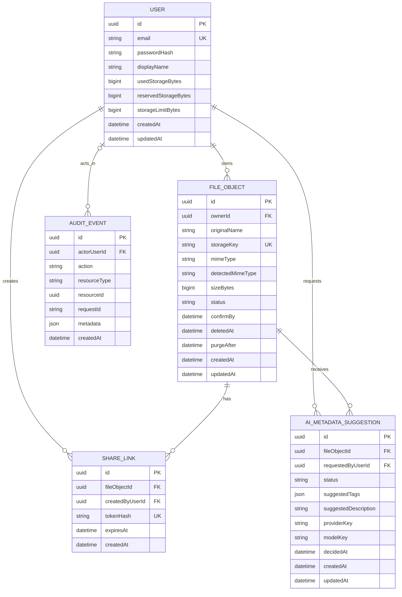
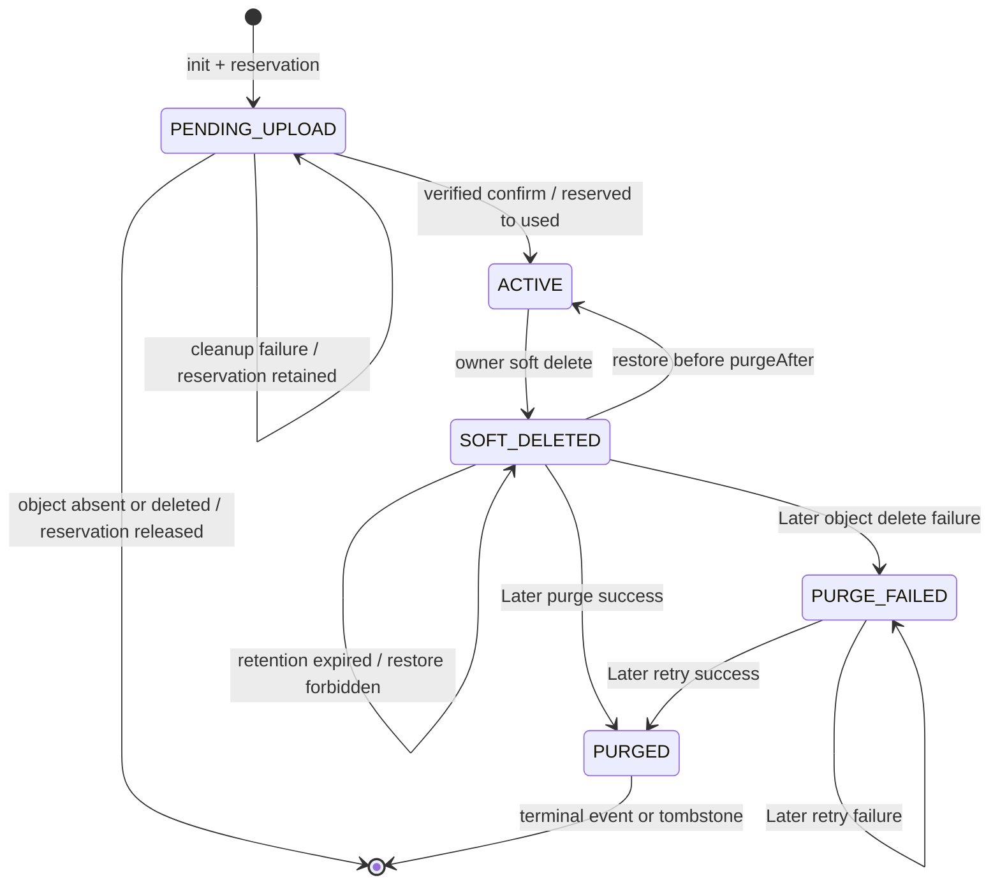
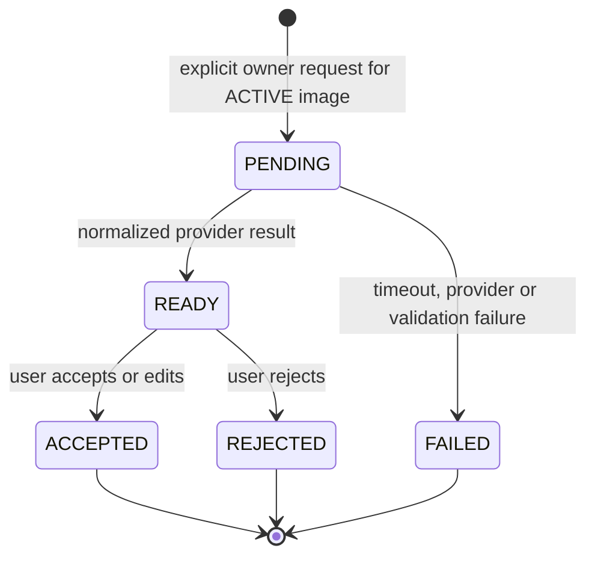

# Adatmodell

**Tervezett állapot – nem implementált funkcionalitás.**

Jelenleg nincs `schema.prisma`, migráció vagy futó PostgreSQL-adatbázis. Ez a dokumentum a későbbi séma kanonikus tervezési szerződése; implementációkor a Prisma schema és e leírás eltérése nem maradhat jelöletlen.

## Modellezési határ

- A bináris kép- és videotartalom privát MinIO/S3 object storage-ban él.
- PostgreSQL az identity, ownership, fájlállapot, kvóta, share link, audit és opcionális MI-javaslat metaadatát tárolja.
- A tárolási kulcs belső adat; API-válaszban nem jelenik meg.
- Minden bájtszámláló nem negatív `BigInt`, minden időpont UTC.
- A `Core MVP` entitásai: `User`, `FileObject`, `ShareLink`, `AuditEvent`.
- Az `AiMetadataSuggestion` kizárólag `MVP+`; hiánya nem akadályozhat core migrációt vagy működést.

## ERD



Az ERD az olvashatóság kedvéért nem mutat minden nullable, cleanup- és `Later` mezőt; az alábbi táblák a teljes tervezett szerződést adják.

## Entitások

### `User`

| Mező | Típus és korlát | Fázis | Jelentés |
|---|---|---|---|
| `id` | UUID, PK | Core MVP | Átlátszatlan felhasználó-azonosító |
| `email` | normalizált string, unique | Core MVP | Bejelentkezési azonosító; válaszokban csak a saját user kapja |
| `passwordHash` | string | Core MVP | Jelszóhash; soha nem kerül API-ba, logba vagy audit metadata-ba |
| `displayName` | validált string | Core MVP | Megjelenítési név |
| `usedStorageBytes` | BigInt, default 0, `>= 0` | Core MVP | Aktivált és fizikailag még létező objektumok denormalizált mérete |
| `reservedStorageBytes` | BigInt, default 0, `>= 0` | Core MVP | Pending uploadok deklarált, ideiglenesen foglalt mérete |
| `storageLimitBytes` | BigInt, `> 0` | Core MVP | Felhasználói kvóta |
| `createdAt` | timestamp | Core MVP | Létrehozás |
| `updatedAt` | timestamp | Core MVP | Utolsó módosítás |

Kötelező invariáns:

```text
0 <= usedStorageBytes
0 <= reservedStorageBytes
usedStorageBytes + reservedStorageBytes <= storageLimitBytes
```

Az utolsó feltételt az upload init tranzakciójának versengő kéréseknél is garantálnia kell.

### `FileObject`

| Mező | Típus és korlát | Fázis | Jelentés |
|---|---|---|---|
| `id` | UUID, PK | Core MVP | Fájlmetaadat azonosító |
| `ownerId` | UUID, FK → User | Core MVP | Tulajdonos és authorization határ |
| `originalName` | validált string | Core MVP | Kizárólag display/download név; storage key nem ebből képződik |
| `storageKey` | string, unique | Core MVP | Backend által generált belső object key |
| `mimeType` | string | Core MVP | Kliens által deklarált, initkor allowlistelt MIME |
| `detectedMimeType` | nullable string | Core MVP | Confirmkor magic numberből detektált MIME |
| `sizeBytes` | BigInt, `> 0`, max. 100 MB | Core MVP | Initkor deklarált, confirmkor `HEAD` alapján igazolandó méret |
| `checksum` | nullable string | Later | Csak külön end-to-end checksum döntéssel; S3 ETag önmagában nem igazolás |
| `visibility` | enum, default `PRIVATE` | Core MVP | A bucket és a fájl privát; share link nem változtat tulajdonjogot |
| `status` | FileStatus | Core/Later | Fájl-életciklus |
| `uploadUrlExpiresAt` | timestamp | Core MVP | A kiadott PUT URL tervezett, alapértelmezetten 5 perces lejárata |
| `confirmBy` | timestamp | Core MVP | Init után 15 perc: 5 perces upload URL és további 10 perces confirm-grace vége |
| `cleanupRetryAfter` | nullable timestamp | Core MVP | Invalid/abandoned cleanup következő lehetséges próbája |
| `cleanupAttemptCount` | integer, default 0 | Core MVP | Operációs retry-számláló; backoff technológia nincs kiválasztva |
| `cleanupLastErrorCode` | nullable string | Core MVP | Biztonságos, belső hibakategória, providerüzenet vagy URL nélkül |
| `deletedAt` | nullable timestamp | Core MVP | Soft delete időpontja |
| `purgeAfter` | nullable timestamp | Core MVP | Restore-jogosultság vége, `deletedAt + 30 nap` |
| `tags` | string lista, default üres | MVP+ | Ember által elfogadott/szerkesztett kanonikus címkék |
| `description` | nullable string | MVP+ | Ember által elfogadott/szerkesztett kanonikus leírás |
| `createdAt` | timestamp | Core MVP | Létrehozás |
| `updatedAt` | timestamp | Core MVP | Utolsó módosítás |

Tervezett `FileStatus`:

- `PENDING_UPLOAD`: init megtörtént, reservation él, a fájl nem listázható aktívként.
- `ACTIVE`: `HEAD` és bounded range magic-number validáció után aktivált fájl.
- `SOFT_DELETED`: normál listából rejtett, retention alatt visszaállítható vagy lejárat után purge-ra váró fájl.
- `PURGE_FAILED`: `Later` állapot, ha a retention purge object delete lépése hibázott.
- `PURGED`: nem kötelezően perzisztált rekordállapot, hanem terminális audit/domain esemény; a későbbi stratégia a rekord törlését vagy minimális tombstone-ját választhatja.

Invalid és abandoned upload cleanup-hibánál a rekord `PENDING_UPLOAD` marad, reservationnel és retry metadata-val. Nem vezetünk be nem jóváhagyott queue- vagy cleanup-enumot.

### `ShareLink`

| Mező | Típus és korlát | Fázis | Jelentés |
|---|---|---|---|
| `id` | UUID, PK | Core MVP | Megosztás azonosító |
| `fileObjectId` | UUID, FK → FileObject | Core MVP | Csak aktív fájlhoz hozható létre |
| `tokenHash` | SHA-256 string, unique | Core MVP | A 32 random byte base64url token egyirányú lenyomata; raw token nem tárolható |
| `createdByUserId` | UUID, FK → User | Core MVP | A létrehozó owner |
| `expiresAt` | timestamp | Core MVP | Kötelező lejárat, létrehozástól 1 óra–7 nap |
| `createdAt` | timestamp | Core MVP | Létrehozás |
| `revokedAt` | nullable timestamp | Later | Visszavonás |
| `maxAccessCount` | nullable integer | Later | Opcionális hozzáférési limit |
| `accessCount` | integer, default 0 | Later | Analitikai/limit számláló |

A raw token 32 kriptográfiailag véletlen bájt base64url kódolása, és csak a létrehozási válaszban jelenhet meg. A `tokenHash` ennek SHA-256 hash-e. Az `expiresAt` a létrehozástól számított minimum 1 óra és maximum 7 nap.

Soft delete-kor a fájl összes meglévő `ShareLink` rekordja ugyanabban a tranzakcióban törlődik. Restore nem rekonstruálja ezeket; új megosztáshoz új token szükséges. Ez belső lifecycle-szabály, nem általános felhasználói revoke API.

### `AuditEvent`

| Mező | Típus és korlát | Fázis | Jelentés |
|---|---|---|---|
| `id` | UUID, PK | Core MVP | Append-only eseményazonosító |
| `actorUserId` | nullable UUID, FK → User | Core MVP | Authenticated actor; publikus share eseménynél lehet null |
| `action` | stabil enum/string | Core MVP | Például login outcome, upload init/confirm, delete, restore, share create/validate |
| `resourceType` | string | Core MVP | Erőforrás-kategória |
| `resourceId` | nullable UUID | Core MVP | Átlátszatlan resource referencia |
| `requestId` | string | Core MVP | Kéréskorreláció |
| `metadata` | JSON, allowlistelt kulcsok | Core MVP | Csak nem érzékeny státusz- és hibakategória |
| `createdAt` | timestamp | Core MVP | Eseményidő |

Audit metadata nem tartalmazhat jelszót, password hash-t, JWT-t, raw share tokent, presigned URL-t, storage credentialt, fájltartalmat vagy nyers MI input/outputot. Audit UI nem Core MVP.

### `AiMetadataSuggestion`

| Mező | Típus és korlát | Fázis | Jelentés |
|---|---|---|---|
| `id` | UUID, PK | MVP+ | Javaslat azonosító |
| `fileObjectId` | UUID, FK → FileObject | MVP+ | Csak owner `ACTIVE` képéhez |
| `requestedByUserId` | UUID, FK → User | MVP+ | Explicit indító felhasználó |
| `status` | AiSuggestionStatus | MVP+ | Human-in-the-loop életciklus |
| `suggestedTags` | string lista/JSON | MVP+ | Provider normalizált címkejavaslata |
| `suggestedDescription` | nullable string | MVP+ | Provider normalizált leírásjavaslata |
| `acceptedTags` | nullable string lista/JSON | MVP+ | Változatlan vagy szerkesztett elfogadott érték |
| `acceptedDescription` | nullable string | MVP+ | Változatlan vagy szerkesztett elfogadott érték |
| `providerKey` | string | MVP+ | Minimális provenance; nem credential |
| `modelKey` | nullable string | MVP+ | Dokumentált modell/verzió referencia |
| `failureCode` | nullable string | MVP+ | Biztonságos, normalizált hibakategória, raw válasz nélkül |
| `decidedAt` | nullable timestamp | MVP+ | Accept/reject időpont |
| `createdAt` | timestamp | MVP+ | Kérés időpontja |
| `updatedAt` | timestamp | MVP+ | Utolsó állapotváltozás |

`AiSuggestionStatus`: `PENDING`, `READY`, `ACCEPTED`, `REJECTED`, `FAILED`.

Raw kép, presigned URL és nyers provider-válasz nem tárolható e rekordban. Provider retention, régió és licenc külön privacy go/no-go feltétel.

## FileObject állapotgép



Fontos különbség: a 30 napos `purgeAfter` a restore-jogosultság vége, nem garantált fizikai törlési SLA. Az automatizált retention purge `Later`, míg a soha nem aktivált pending/abandoned upload cleanup `Core MVP`.

## MI-javaslat állapotgép



Retry új, explicit javaslatkérést hoz létre; korábbi `FAILED` vagy `REJECTED` rekord nem alkalmazható automatikusan.

## Tranzakciós invariánsok

### Upload init

Egy adatbázis-tranzakció:

1. ellenőrzi az ownert és a méret-/MIME-alapfeltételeket;
2. zárolási vagy azzal egyenértékű concurrency stratégiával ellenőrzi a kvótát;
3. létrehozza a `PENDING_UPLOAD` rekordot;
4. ugyanabban a tranzakcióban növeli a `reservedStorageBytes` értékét.

Rollback esetén sem pending rekord, sem reservation nem maradhat.

### Idempotens confirm

Storage `HEAD` és bounded range-read után egy tranzakció:

1. csak `PENDING_UPLOAD` rekordot aktivál;
2. ugyanazzal a `sizeBytes` értékkel csökkenti a reservationt és növeli a used számlálót;
3. beállítja a detektált MIME-t és `ACTIVE` státuszt;
4. audit eseményt ír érzékeny adat nélkül.

`ACTIVE` rekord ismételt confirmja ugyanazt a reprezentációt adó no-op. Számláló nem változhat másodszor.

### Invalid vagy abandoned cleanup

- Object-not-found igazolás vagy sikeres object delete után a pending rekord lezárható/törölhető és a reservation feloldható.
- Storage delete hiba esetén a rekord, reservation és retry metadata megmarad.
- Providerüzenet, URL és credential nem kerül adatbázisba.

### Soft delete és restore

- `ACTIVE → SOFT_DELETED`: `deletedAt = now`, `purgeAfter = now + 30 nap`.
- Ugyanebben a tranzakcióban a fájl összes meglévő ShareLink rekordja törlődik.
- `SOFT_DELETED → ACTIVE`: csak `now < purgeAfter`; a két időmező törlődik.
- Egyik átmenet sem változtatja a used vagy reserved számlálót.
- Soft-deleted fájlhoz share read URL nem adható; restore korábbi linket nem éleszt újra.

### Later purge

Csak igazolt, idempotens object delete után csökkenthető `usedStorageBytes`. Storage-hiba `PURGE_FAILED` állapotot hagy; a konkrét worker/queue és tombstone stratégia külön későbbi döntés.

## Indexek és constraint-ek

Tervezett minimum:

- unique `User.email`;
- unique `FileObject.storageKey`;
- összetett index `FileObject(ownerId, status, createdAt, id)` a cursor-listákhoz;
- index `FileObject(status, confirmBy)` a pending cleanup kiválasztásához;
- index `FileObject(status, purgeAfter)` a későbbi retention purge kiválasztásához;
- unique `ShareLink.tokenHash` és index `ShareLink(expiresAt)`;
- index `AuditEvent(createdAt)`, valamint szükség szerint `resourceType + resourceId`;
- index `AiMetadataSuggestion(fileObjectId, status, createdAt)` csak az MVP+ migrációban;
- adatbázis- vagy service constraint minden bájtszámláló nemnegativitására.

A cursor a `createdAt + id` párost használja `DESC` sorrendben; az `id` tie-breaker miatt azonos timestamp esetén is determinisztikus.

## Fájlformátum allowlist

A Core MVP pontos allowlistje: `image/jpeg`, `image/png`, `image/webp`, `image/gif`, `video/mp4`, `video/webm`. Initkor a deklarált MIME-nak, confirmkor a detektált MIME-nak is ezen a listán kell szerepelnie, és egyezniük kell. HTML, SVG, JavaScript, XML, ismeretlen és sérült tartalom nem aktiválható.

## Törlési és retention-szabályok

- A Core MVP user delete soft delete, 30 napos restore-ablakkal.
- A 30. nap nem fizikai törlési garancia; automatizált purge nincs a Core MVP-ben.
- Share-link nem fér hozzá nem aktív fájlhoz.
- A felhasználói fiók végleges törlése és a relációk cascade/restrict policyja nincs a Core MVP scope-ban; bevezetése előtt privacy és lifecycle döntés szükséges.
- Audit- és MI-javaslat-retention konkrét időtartama implementáció előtti privacy döntés; addig production adatkezelés nem indítható.
