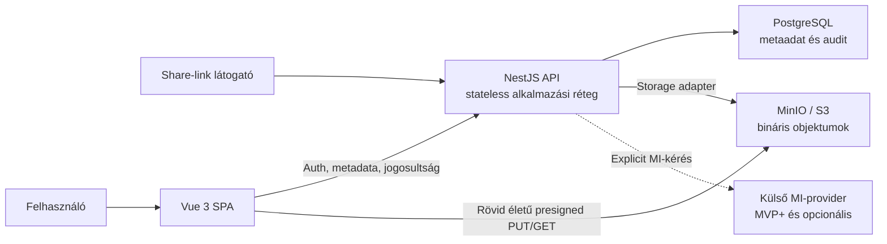

# Szakdolgozati high-level terv

## Státusz

**Tervezett célállapot – nem implementált funkcionalitás.**

Ez a dokumentum a szakdolgozat stabil, high-level irányát rögzíti. A részletes termékscope forrása a [scope contract](01_product/scope_contract.md), a technikai döntéseké az [ADR-készlet](02_architecture/adr/README.md), az interfész- és adatmodell-szerződéseké pedig a [design dokumentáció](03_design/README.md). A repository jelenleg nem tartalmaz futtatható frontend- vagy backendalkalmazást.

## 1. Cél és szakdolgozati fókusz

A projekt célja egy S3-kompatibilis objektumtárolóra épülő személyes médiafájl-kezelő webalkalmazás megtervezése és későbbi megvalósítása. A rendszer képek és rövid videók teljes alapvető életciklusát kezeli: feltöltés, saját fájlok böngészése, preview, letöltés, tárhelyhasználat, időkorlátos megosztás, soft delete és visszaállítás.

A szakdolgozati érték nem pusztán a fájlfeltöltés, hanem annak bemutatása, hogy az object storage, a relációs metaadat-kezelés, a jogosultság, a megbízhatóság, a skálázhatóság és az ellenőrizhető AI-asszisztált fejlesztés hogyan áll össze egy termékszerű rendszertervvé.

## 2. Négy szakmai pillér

### 2.1 Core cloud-storage MVP

- Regisztráció, bejelentkezés és védett frontend.
- Legfeljebb 100 MB-os kép vagy rövid videó feltöltése privát MinIO/S3 bucketbe.
- Backend által kontrollált, rövid életű presigned URL-ek; tartós storage credential nem kerül a frontendhez.
- Metaadatok PostgreSQL-ben, bináris tartalom object storage-ban.
- Saját fájlok cursor-lapozott listázása, biztonságos preview és letöltés.
- Denormalizált tárhelyhasználat, soft delete, 30 napos egyedi restore és alap időkorlátos megosztás.
- Backend oldali authorization, egységes hibamodell és unit tesztek a core logikára.

### 2.2 Megbízható fájl-életciklus

- A feltöltés `PENDING_UPLOAD` állapotból indul és csak ellenőrzött confirm után válhat `ACTIVE` állapotúvá.
- A deklarált méret ideiglenes kvótafoglalást kap; félbehagyott vagy hibás upload nem növelheti a tartós tárhelyhasználatot.
- Confirmkor a backend object metadata ellenőrzést és bounded range-read alapú magic-number vizsgálatot végez.
- A confirm idempotens: egy fájl pontosan egyszer növelheti a `usedStorageBytes` értékét.
- Soft delete alatt az objektum továbbra is foglal tárhelyet; restore nem változtat az elszámoláson.
- Soft delete végleg invalidálja a fájl meglévő share-linkjeit; restore után új megosztás szükséges.
- Az automatizált purge későbbi fázis. Tervezett működése idempotens, retry-képes, és csak sikeres storage-törlés után csökkenti a használatot.
- A fontos állapotváltozásokról alap audit esemény készül, külön audit UI nélkül.

### 2.3 Skálázhatóság és karbantarthatóság

- A backend alkalmazási állapota PostgreSQL-ben és object storage-ban él; az API stateless módon több példányra skálázható.
- A fájllista determinisztikus, `createdAt + id` alapú cursor paginationt használ.
- A bináris adatforgalom nem halad át tartósan a backend API-n.
- A storage adapter elfedi a MinIO, AWS S3 és OCI S3-kompatibilis eltéréseinek releváns részét.
- A backend modulhatárai elkülönítik az auth, users, files, storage, sharing, audit, health, config és common felelősségeket.
- A purge és az opcionális MI-feldolgozás később külön workerbe szervezhető; a konkrét queue-technológia nem része a jelenlegi döntésnek.
- A dokumentáció, ADR-ek és unit tesztek a továbbvihetőség részei, nem utólagos kiegészítések.

### 2.4 Opcionális MI-metaadat-javaslat

Az alkalmazásba épülő MI-funkció nem azonos az AI-asszisztált fejlesztési folyamattal. A termék-MI külön, core MVP utáni `MVP+` képesség:

- első körben csak aktív képekhez;
- explicit felhasználói indítással;
- javasolt címkékkel és rövid leírással;
- elfogadható, szerkeszthető vagy elutasítható eredménnyel;
- provider adapteren keresztül, a core storage működéstől függetlenül;
- arcfelismerés, biometria és érzékeny tulajdonságok következtetése nélkül.

MI-provider hiba vagy hiányzó konfiguráció nem akadályozhat feltöltést, böngészést, letöltést, törlést vagy megosztást.

## 3. Scope-határok

### Core MVP

A kötelező core MVP a [hat user storyból](01_product/scope_contract.md) áll: auth, feltöltés, saját fájlok használata, tárhelyhasználat, alap megosztás, soft delete és restore. Keresztmetszeti követelmény a pending upload kezelése, cursor pagination, stateless API, idempotens confirm, alap audit és az MI-től független működés.

### MVP+

Az opcionális MI-címke- és leírásjavaslat csak a stabil core MVP után kezdhető el. Nem része a core Definition of Done feltételeinek, és külön go/no-go döntést igényel a provider, adatkezelés és szükséges dependency-k előtt.

### Later

- Automatizált végleges purge worker.
- Multipart upload és 100 MB-nál nagyobb videók.
- AWS- vagy OCI-deployment.
- Integration, contract és e2e tesztek.
- CI/CD pipeline és fejlett monitoring dashboard.
- Thumbnail-generálás, transzkódolás, adminfelület és fejlett keresés.
- Share-link visszavonás, hozzáférésszám-limit és analitika.

## 4. Célarchitektúra

Fő szerződések:

- A frontend nem hoz authorization-döntést és nem tárol S3/MinIO credentialt.
- A backend ellenőrzi a felhasználót, ownershipet, kvótát, fájlállapotot és share-linket.
- A storage adapter kezeli a presign, object metadata, bounded range-read és delete műveleteket.
- A PostgreSQL a felhasználók, fájlmetaadatok, kvótaszámlálók, share token hash-ek, audit események és opcionális MI-javaslatok forrása.
- A külső MI-provider nem core rendszerfüggőség.

## 5. Fontos lezárt döntések

- Vue 3 + Vite + TypeScript + Tailwind CSS frontend.
- Node.js + TypeScript + NestJS backend.
- PostgreSQL + Prisma metaadat-kezelés.
- Privát S3-kompatibilis object storage, lokálisan MinIO.
- Backend-kontrollált presigned URL flow; a backend proxy nem automatikus fallback.
- `User.usedStorageBytes` és `User.reservedStorageBytes` külön számláló.
- 30 napos soft delete retention; usage csak végleges purge után csökken.
- Magic-number alapú backend validáció.
- Egyórás JWT `HttpOnly`, `SameSite=Lax` cookie-ban; localStorage és core refresh-token flow nélkül.
- Multipart upload és automatizált purge tudatosan későbbi fázis.

A részletes indoklásokat az [ADR-index](02_architecture/adr/README.md) tartalmazza.

## 6. Minőségi és biztonsági alapelvek

- Minden védett erőforrásnál backend oldali authentication és ownership check szükséges.
- HTML, SVG, JavaScript, XML és ismeretlen bináris tartalom nem jeleníthető meg inline.
- Jelszó, token, presigned URL, fájltartalom és nyers MI input/output nem kerülhet logba.
- Az eredeti fájlnév csak display metadata; a storage key rendszer által generált.
- Share token csak hash formában tárolható, és kötelező lejárattal rendelkezik.
- Az API hibái stabil kódot, user-friendly üzenetet és request ID-t adnak belső részletek nélkül.
- A unit tesztelés minden jövőbeli vertikális szelet része; integration/e2e csak később indul.
- A dokumentáció nem állíthat implementáltként olyan képességet, amelyhez nincs kód és verifikációs evidence.

## 7. Sikerkritérium

A szakdolgozati projekt akkor erős, ha a későbbi core MVP reprodukálhatóan futtatható, a hat user story végigdemonstrálható, a jogosultsági és lifecycle-szabályok teszteltek, az architektúradöntések visszakövethetők, és a dokumentáció egyértelműen elválasztja a megvalósított, tervezett és későbbi képességeket.

Az opcionális MI-funkció csak akkor növeli a scope-ot, ha a core storage MVP stabil, a privacy-korlátok elfogadottak, és a provider kiesése mellett is teljes értékű marad az alap rendszer.

## 8. Következő végrehajtási sorrend

A részletes, evidence-alapú sorrendet a [mérföldkő-dokumentum](milestones.md) tartalmazza. A repository jelenlegi feladata a dokumentációs rebaseline lezárása; alkalmazáskód csak ezt követő, külön kért implementációs feladatban készülhet.
