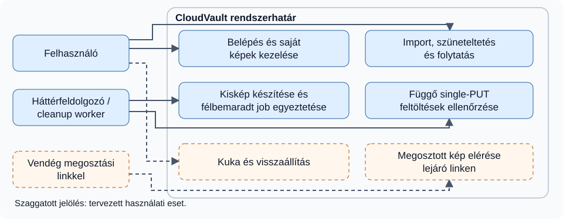
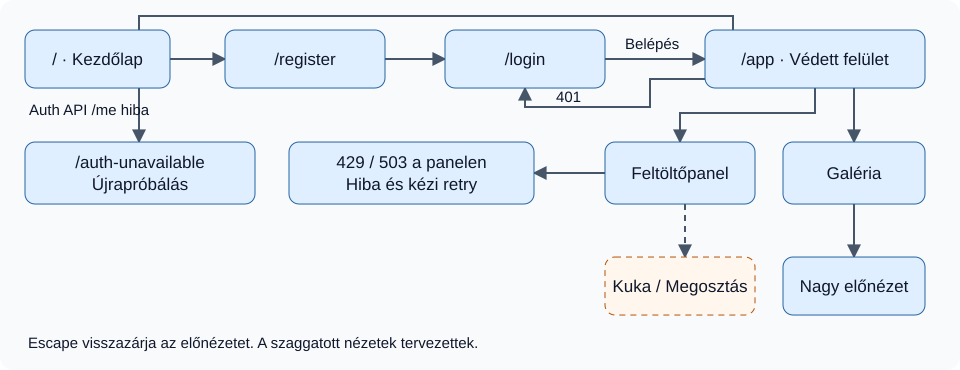
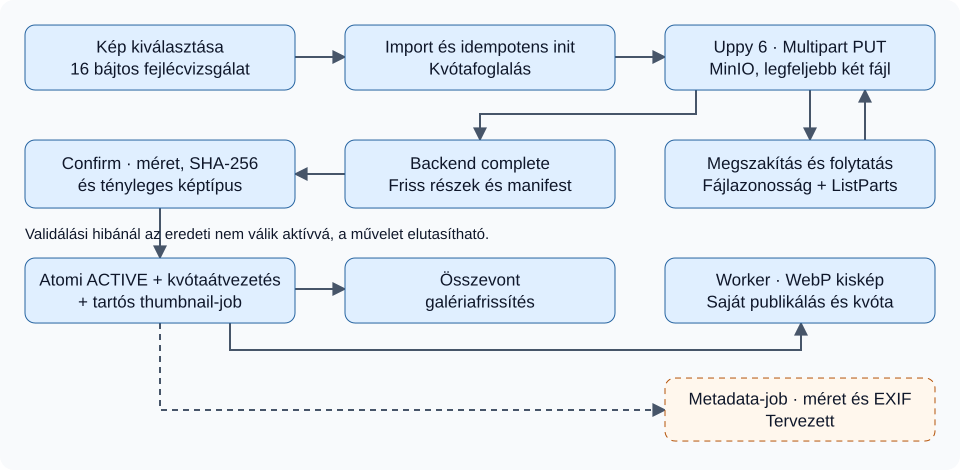
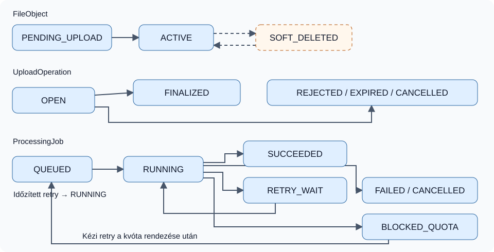
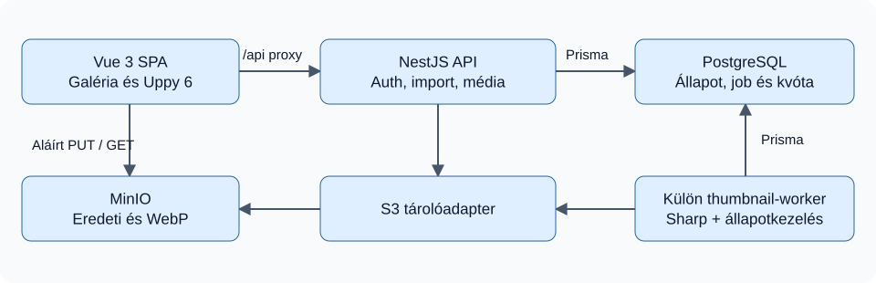
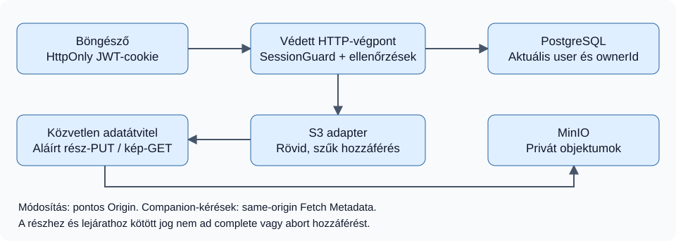
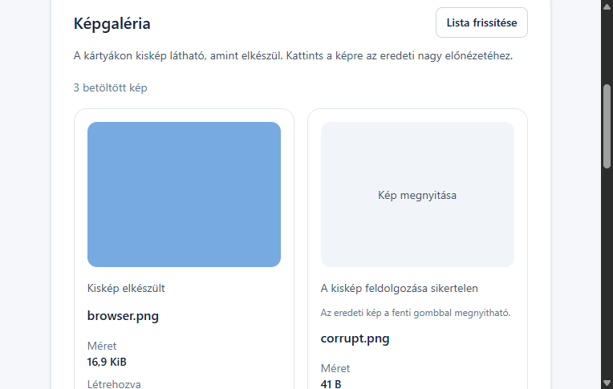
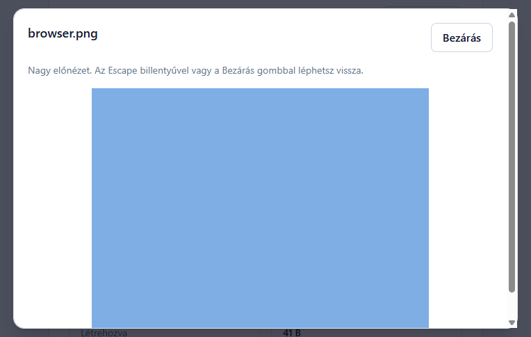

# Adattárolás a felhőben – CloudVault

**Szakdolgozati kézirat · v2 · 2026. november 10.**

**Vizsgált implementáció:** `main`, `61d77ee`. A futtatási eredményeknél az adott próba verziója és környezete szerepel.

## 1. Bevezetés és problémafelvetés

A CloudVault böngészőből használható személyes médiatár. A vizsgált helyzetben a felhasználó több képet tölt fel egyszerre, az adatátvitel közben megszakad a kapcsolat, vagy az egyik fájl feldolgozása hibával végződik. A kész elemeknek továbbra is elérhetőknek kell maradniuk. A megszakított átvitelt a tároló által már visszaigazolt részek megtartásával kell folytatni, miközben a rendszer pontosan követi az elfoglalt és a lefoglalt tárhelyet.

A dolgozat mérnöki kérdése, hogyan kapcsolható össze a közvetlen objektumtárolós feltöltés, a szerveroldali jogosultság és a tartós háttérfeldolgozás. Az eredeti kép láthatóvá tétele, a kvóta könyvelése és a feldolgozási feladat indítása olyan összefüggő műveletek, amelyeknél egy ismételt kérés vagy egy elveszett válasz sem okozhat kétszeres elszámolást. Az értékelés az egész fájlt újraküldő és a részenként folytatható átvitelt hasonlítja össze ellenőrzött megszakítás mellett.

## 2. Követelményspecifikáció

A felhasználó regisztráció után saját médiatárat ér el. Kötegenként több képet választhat, fájlonként látja az előrehaladást és a hibát, valamint az importot újbóli belépés vagy oldalfrissítés után is megnyithatja. Folytatáskor szükség esetén ismét kiválasztja a helyi fájlt. A rendszernek ellenőriznie kell annak tartalmi azonosságát, és ki kell hagynia a kész fájlokat és részeket.

**1. táblázat. A követelmények és a vizsgált verzió állapota**

| Terület | Elvárt működés | Állapot a vizsgált verzióban |
|---|---|---|
| Hozzáférés | Regisztráció, belépés, saját média, kijelentkezés | Megvalósított. A kézi hitelesítési próbák eredménye a riportban szerepel. |
| Képimport és galéria | Részleges siker, folytatás, saját kártyák, nagy előnézet | Multipart panel és galéria megvalósítva. Az új adatút valós böngészős és tárolós próbája folyamatban van. |
| Feldolgozás | Kiskép, felbontás és elérhető EXIF-idő, külön retry és helyreállítás | A thumbnail és tartós worker megvalósított. A metadata-processor tervezett. |
| Tárhely | Egyszeri foglalás és elszámolás, használt és foglalt bájtok kijelzése | A backend könyvelése működik. A vizuális kvótakijelző tervezett. |
| Életciklus | Letöltés, Kuka és visszaállítás, időkorlátos megosztás | Célállapot. A soft delete és a megosztás adatmodellje rendelkezésre áll. |
| Értékelés | Reprodukálható összehasonlítás és felhasználói próba | Elkülönített PoC és helyi technikai tesztek dokumentáltak. A teljes mérés és a külső felhasználói próba nyitott. |

A második feldolgozó követelménye a szélesség és magasság, valamint a rendelkezésre álló EXIF-készítési idő kinyerése. A hiányzó időpont érvényes eredmény. A feldolgozók eredményének elkülönítése biztosítja, hogy az egyik feladat hibája esetén a másik eredménye és az eredeti kép használható maradjon.

**1. ábra. Használati esetek és rendszerhatár.** A folytonos elemek az elérhető felhasználói és háttérműveleteket jelölik. A Kuka és a vendég hozzáférése a célállapot része. A cleanup worker itt a meglévő single-PUT ellenőrzési folyamatot jelenti.

**2. ábra. Oldalfolyam és hibakezelés.** A védett oldal munkamenet-ellenőrzésének 401-es válasza a belépéshez vezet. Az átmeneti ellenőrzési hiba külön újrapróbálási oldalra irányít. Az alkalmazáson belüli 429/503 hibákhoz a feltöltőpanel a saját állapotában ad visszajelzést.

## 3. Rendszerterv és architektúra

### 3.1. Adatút és állapotmodell

A Vue 3 és TypeScript alapú kliens Vite-tal épül. A NestJS szerver végzi a hitelesítést, a tulajdonosi ellenőrzést és az állapotátmeneteket. A relációs állapotot Prisma közvetítésével PostgreSQL tárolja. A bináris eredeti és a származtatott kép MinIO-ban kap helyet. A thumbnail-worker külön Compose-szerepben fut, ugyanarra a tartós feladatállapotra és a tárolóadapterre támaszkodva.

A vezérlő és a bináris adatút szétválasztása a megoldás egyik döntése. A backend engedélyezi az adott rész feltöltését és ellenőrzi az eredményt, a bájtok közvetlenül a böngésző és a MinIO között haladnak. A teljes fájlt újraküldő single-PUT megoldás megmaradt összehasonlítási alapnak. A közvetlen S3 multipart út a kész részek megőrzésével mérsékli az újraküldést. Az 5 MiB-os alapbeállítás mellett a kisebb kép egyetlen rész, így félbeszakadásakor a részt teljes egészében újra kell küldeni. [Multipart PoC és tervezési döntés](02_architecture/adr/ADR-017-direct-multipart-poc.md)

**3. ábra. Kötegelt feltöltés és feldolgozás.** Az eredeti aktiválása egy tranzakcióban rögzíti a kvótaátvezetést és a thumbnail-jobot. A galéria frissítése az eredeti sikeres megerősítését követi. A kiskép ettől függetlenül készül el. A szaggatott metadata-ág a második feldolgozó tervezett helye.

**4. ábra. A fájl, a feltöltési művelet és a feldolgozási feladat fő állapotai.** Az ábra a fő útvonalakat mutatja. Időzített retry esetén a worker a `RETRY_WAIT` állapotból közvetlenül átveheti a feladatot. A kvótablokkolás feloldása után a kézi retry sorba állítja a feladatot. A multipart átviteli állapot ettől külön kezeli a függő létrehozást, összeállítást és egyeztetést. A bizonytalan storage-kimenet megőrzi a foglalást. A `SOFT_DELETED` mezőérték a sémában létezik, a szaggatott átmenetek a tervezett Kuka-folyamatot jelölik. [Adatmodell](03_design/data_model.md)

**5. ábra. Az alkalmazás architektúrája.** A vezérlőhívások és a worker állapota PostgreSQL-hez kapcsolódnak. A böngésző aláírt kéréssel ér el egy meghatározott MinIO-műveletet, a szerver és a worker az S3-adapteren keresztül dolgozik.

### 3.2. Biztonsági modell

A munkamenetet a szerver HttpOnly cookie-ban továbbított, időkorlátos JWT alapján ellenőrzi. A védett kéréshez a SessionGuard az adatbázisban is azonosítja az aktuális felhasználót. A média- és importműveleteknél a tulajdonosra szűrés a backend feladata. A módosító kérések az engedélyezett Origint igénylik. Az Uppy Companion-kompatibilis végpontjai azonos originről érhetők el a Vite vagy az nginx proxyján át. Ezeknél a szerver a böngésző Fetch Metadata fejlécét is ellenőrzi.

Az aláírt URL az engedélyezett tárolóműveletre szól, és lejáratig használható. A kliens rövid életű részfeltöltési vagy képolvasási jogot kap. A multipart véglegesítése szerveroldali marad. A galéria az előnézeti URL-eket memóriában kezeli. A backend hozzáférési adatai a kiszolgálón maradnak. [Biztonsági modell](05_security_ops/threat_model.md)

**6. ábra. Hitelesítés, jogosultság és tárolóhozzáférés.** A szerver az érvényes munkamenet és a megfelelő tulajdonos ellenőrzése után adhat ki rövid életű tárolójogot. A teljesítéshez és a megszakítás véglegesítéséhez a böngésző az alkalmazás szerverét hívja.

## 4. Implementáció

### 4.1. Regisztráció és munkamenet

A regisztráció megjelenítési nevet, email-címet és jelszót fogad. A jelszómegerősítés a kliensoldali űrlap része. A szerver külön validálja a bemenetet. A jelszó legalább 15 Unicode-kódpontból áll, és tartalmaz nagybetűt, számjegyet és írásjelet vagy szimbólumot. A felső korlát 1024 UTF-8 bájt. A jelszó karaktereit a szerver változtatás nélkül adja át a hash-elésnek.

A jelszóhoz az aszinkron Node.js `scrypt` művelet egyedi saltot használ. A beállítás `N=131072`, `r=8` és `p=1`. A függvény 16 véletlen saltbájtot és 64 bájtos származtatott kulcsot használ. A verziózott tárolási rekord az algoritmus paramétereit is megőrzi. A regisztráció az email egyediségét adatbázis-korláttal garantálja. A Prisma 7 PostgreSQL-adapter egyediségütközésének strukturált alakjához külön hibamapping és regressziós teszt készült. A belépés után az `/app` útvonal a szervertől kér munkamenet-ellenőrzést. A sikeres kijelentkezés törli a cookie-t. [Hitelesítési döntés](02_architecture/adr/ADR-010-jwt-http-only-cookie-auth.md)

### 4.2. Folytatható feltöltés és elszámolás

A kliens a fájl elejének 16 bájtos vizsgálatával ismeri fel a támogatott képformátumot, majd teljes SHA-256 értéket számol a folytatáskori fájlazonossághoz. A szerver az idempotens inicializáláskor tartós import- és átviteli azonosítót tárol, valamint lefoglalja a fájl méretének megfelelő kvótát. A foglalás újbóli kérésnél ugyanahhoz az importelemhez tartozik.

A panel két fájl munkáját engedi párhuzamosan, és fájlonként sorban tölti a részeket. Az Uppy 6 a Companion-kompatibilis JSON adaptert használja. A könyvtár virtuális átviteli azonosítókkal dolgozik. A szerver a valódi tárolói azonosítókat megtartja az adapter mögött. Az Uppy újranyitáskor a tárolótól visszaigazolt részlistából indul. A szüneteltetés megszakítja a helyi kérést, miközben megőrzi a folytatáshoz szükséges importot. A felhasználó végleges megszakítást külön művelettel kezdeményezhet. [ADR-018](02_architecture/adr/ADR-018-uppy6-companion-bridge.md)

A szerver az összeállítás előtt friss részlistából építi fel a végleges manifestet. Az összeállított objektum megerősítésekor újra ellenőrzi a méretet, a teljes hash-t és a képtípust. A sikeres tranzakció az eredetit `ACTIVE` állapotba teszi, átvezeti a foglalt bájtokat a használt tárhelybe, és létrehozza a tartós thumbnail-jobot. Az egyediség és az állapotfeltételek védenek az ismételt megerősítésből eredő újabb könyveléstől. Bizonytalan tárolói kimenetnél az egyeztetés az előző művelet eredményét keresi, a foglalást igazolt állapotig megtartva. [API-szerződés](03_design/api.md)

### 4.3. Galéria és háttérfeldolgozás

A galéria a saját aktív képeket kurzorral lapozza. A feltöltőpanel a sikeres `ACTIVE` visszaigazolásokból összevont frissítési eseményt küld. A kártyák a generált WebP kisképet kérik, a nagy előnézet megnyitásakor pedig külön hozzáféréssel töltődik be az eredeti. A feldolgozás várakozása, hibája és a képbetöltési hiba külön jelzést kap. A feldolgozás saját újrapróbálása mellett az eredeti megnyitható marad.

A worker a tartós `ProcessingJob` rekordot időkorlátos foglalással veszi át. Az egyes próbálkozások külön állapotot kapnak. A származtatott objektum publikálásához a worker aktuális foglalása és a tárolt eredmény ellenőrzése szükséges. Újraindítás után a worker a már létrejött objektumot egyeztetheti, így a kész eredmény ismételt feltöltése elkerülhető. A kiskép tárhelye külön kerül elszámolásra. A második feldolgozó a közös interfészre épülő következő fejlesztési szelet.

**7. ábra. Galéria kész kisképpel és elkülönített feldolgozási hibával.** A 2026. október 31-i helyi Chrome-retesztben a felületről újonnan feltöltött `browser.png` kártyaképe betöltődött. A sérült kép külön hibás állapotban maradt. Vizsgált kódverzió: `a3a80a8`. [Reteszt](04_quality/test_report.md#th-01th-02-javítás-és-helyi-reteszt--2026-10-31)

**8. ábra. Az eredeti kép nagy előnézete.** A kártyák 512 × 384 képpontos kisképeket használtak, a modál 1024 × 768 képpontos eredetit töltött be. Az Escape bezárta a modált, és a fókusz visszakerült a megnyitó gombra. Forrás: ugyanaz az október 31-i böngészős reteszt.

### 4.4. Fejlesztési módszertan és AI-közreműködés

A fejlesztés kis, ellenőrizhető szeletekre tagolódott. Egy szelet az API vagy adatmodell szerződésével indult, majd a megvalósítást célzott tesztek, dokumentáció és review követte. A Codex tervezési alternatívák, kódvázlatok, tesztötletek és a kézirat előkészítésében működött közre. A GitHub Copilot egyes változtatásokhoz kódreview-t adott. A felhasználói és üzleti szabályokat a szerző a témavezetői visszajelzéshez és a projekt követelményeihez igazította.

Az Uppy-integráció konkrét példája a döntések felülvizsgálatának. Az első javaslat a korábbi verzió külön multipart callbackjeire épült. A telepített Uppy 6 nyilvános interfésze eltért ettől. Az Uppy 5-re váltás felmerült, de a szerző a hatos verzió megtartása és a szerveres illesztés átalakítása mellett döntött. A kiválasztott megoldás a nyilvános Companion-kompatibilis JSON útvonalakra támaszkodik. A döntés során a tulajdonosi ellenőrzés, a szerveroldali véglegesítés és a kvóta megőrzése volt az elfogadás feltétele.

Az asszisztenssel készített teszt is felülvizsgálandó program. A Vue felület korai ellenőrzése során a tesztkörnyezet szerveroldalra fordított sablont adott egy kliensoldali renderernek. A tesztet a tényleges futtatási módhoz kellett igazítani. A galéria későbbi hibáját viszont valódi böngészős próba tárta fel: elkészült a thumbnail, de a kártya nem kérte le. A célzott kliensregresszió után ugyanezt a folyamatot újra lefuttattuk a javított builddel. Ez a sorrend lehetővé tette, hogy a kódhiba javítása és a böngészős működés igazolása külön nyomon követhető legyen.

A promptnapló rögzíti a feladatokat és a létrejött változtatásokat. A verifikációs napló az ellenőrzési módszert, az eredményt és annak határait követi. A kéziratban az AI által javasolt állítások alapja az azonosítható kód, a döntésnapló vagy a dokumentált próba. [Promptnapló](07_ai/prompt_log.md) · [Verifikációs napló](07_ai/verification_log.md)

## 5. Tesztelés és összehasonlító mérések

### 5.1. Eddigi bizonyítékok

Az egységtesztek és sablonpróbák célja az állapotátmenetek, a tulajdonosi ellenőrzések és a hibakezelés reprodukálható vizsgálata. Az alkalmazáspróba a böngésző, a backend, a PostgreSQL és a MinIO együttműködését értékeli. A különálló multipart PoC az adatátviteli mechanizmust és annak korlátait vizsgálta.

**2. táblázat. Dokumentált ellenőrzések és bizonyítási határuk**

| Vizsgálat | Rögzített eredmény | Bizonyítási határ |
|---|---|---|
| Helyi galéria- és thumbnail-reteszt, 2026. október 31., `a3a80a8` | Friss böngészős feltöltésből aktív kép, kiskép és eredeti előnézet. Két fiók elkülönítése, tárolói és adatbázis-egyezés a végrehajtott esetekben. | A későbbi Uppy 6 alkalmazásút külön próbát igényel. |
| Korábbi worker-újraindítási próba, `STORED` fázis | A korábban eltárolt thumbnail jelöltet az új worker sikeresen egyeztette. | Az eredmény a megfigyelt fázisra vonatkozik. |
| Elkülönített böngésző–MinIO multipart PoC, 2026. november 1. | A 15 338 309 bájtos képnél az első 5 242 880 bájtos rész megmaradt. A folytatás 10 095 429 bájtot küldött, és a végső SHA-256 egyezett. | Kísérleti adatút. A mérés alkalmazásszintű payloadot számolt. |
| PoC, 207 964 bájtos kis kép | A félbeszakított egyetlen részt a kliens teljes egészében újraküldte. A végső SHA-256 egyezett. | Igazolja az egyetlen részre eső újraküldés korlátját. |
| Uppy 6 alkalmazásillesztés, 2026. november 3. | Összesítve 1712 sikeres automatikus eset. Szimulált hálózaton a tényleges Uppy könyvtár csak a hiányzó 17 bájtos részt küldte el. | Unit, sablon és szimulált fetch/XHR. |
| Multipart alkalmazáspróba a `main` ágon | **Eredmény és képernyőképek beillesztésre várnak.** | A jelenleg futó szerzői kézi próbához fenntartott hely. |

A helyi galéria-reteszt Chrome-ban, Docker Compose-ban futó PostgreSQL és MinIO mellett készült. A vizsgált A fiókban három eredeti és két kész kiskép öt tárolói objektumnak felelt meg, a használt kvóta 35 645 bájt volt, a foglalt kvóta nulla. A 7–8. ábra ehhez a reteszthez tartozik. A multipart feltöltésről az új alkalmazáspróba dokumentálja majd az első kész rész állapotát, a megszakítást, az oldalfrissítés utáni visszaállítást és az elkészült galériát. A próba mellé rögzíteni kell a commitot, a környezetet, a bemeneti képet és részméretet, az újraküldött részeket, valamint a végső hash-t és a DB/MinIO állapotát. A képernyőképekről ki kell hagyni a munkamenetadatokat és az aláírt URL-eket. [Tesztriport](04_quality/test_report.md) · [PoC mérési artefakt](assets/evidence/multipart-poc-2026-11-01.json)

### 5.2. Összehasonlító mérési terv

Az összehasonlítás 10 és 50 képes csomagokon készül azonos képekkel, hálózati feltételekkel és előre rögzített megszakítási ponttal. A két mód az egész fájlt újraküldő single-PUT alapváltozat és a multipart folytatás. Az 5 MiB alatti és a több részt igénylő képeket külön kell értékelni. A két út eltérő párhuzamosságát azonos beállítással vagy külön megjelölve kell kezelni, hogy a teljes idő értelmezhető maradjon.

Minden ismétlésnél mérendő az újraküldött payload, a teljes átvitel ideje, valamint a helyesen elkészült fájlok és feldolgozási eredmények száma. Az eredményhez azonosítani kell a megszakítási pontot és az időmérés határait. A fájlazonosságot hash, a tárhelyelszámolást és az egyediséget adatbázis- és objektumtároló-ellenőrzés igazolja. A fenti PoC-adatok a mérési módszer kiindulópontjai. A teljes csomagokra vonatkozó összehasonlítás eredménye nyitott.

## 6. Összefoglalás

A vizsgált változatban a személyes galéria, a tartós thumbnail-feldolgozás és a részenként folytatható képimport közös jogosultsági és tárhelyelszámolási szabályokra épül. A megoldás fő hozzájárulása a tároló által igazolt átviteli állapot összekötése a tartós importtal, az atomi megerősítéssel és a háttérfeladattal. A korábbi böngészős reteszt igazolta a galériát és a kiskép használatát, a multipart PoC pedig elkülönített környezetben mérte a kész rész megőrzését.

A következő kéziratváltozatot a teljes multipart alkalmazáspróba, a metadata-processor és a két átviteli mód összehasonlító mérése egészíti ki. A jelenlegi korlátok közé tartozik az egyetlen részből álló képek teljes újraküldése, a bizonytalan írások utáni foglalás igazolt lezárásának igénye és a még nyitott életciklus-funkciók. A végleges értékelés a mérések, a kipróbált telepítés és a felhasználói próbák eredményeire épül majd.

## Hivatkozások

- [Projektterv](plan.md) és [mérföldkövek](milestones.md)
- [API-szerződés](03_design/api.md) és [adatmodell](03_design/data_model.md)
- [Architekturális döntések](02_architecture/adr/README.md)
- [Tesztstratégia](04_quality/test_strategy.md), [tesztriport](04_quality/test_report.md) és [thumbnail-reteszt artefakt](assets/evidence/thumbnail-fix-retest-2026-10-31.json)
