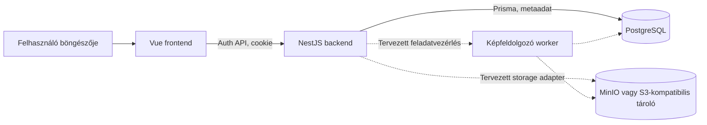

# Adattárolás a felhőben – CloudVault

## Szakdolgozati kéziratdraft

**Változat:** első részleges kézirat, 2026. október 20.

**Vizsgált szoftverállapot:** `197cdec` – a regisztrációs felületet beolvasztó main commit.

**Terjedelem:** probléma és követelmények, technológiai és architekturális döntések, az elkészült hitelesítési rész, AI-használat és korlátok.

> Szerkesztői megjegyzés: ez AI közreműködésével készült, szerzői ellenőrzésre szánt kézirat, nem végleges vagy témavezető által elfogadott dolgozat. A funkciók készültségét a megjelölt kódverzió, a korábbi futtatások eredményét a projekt tesztriportja alapján írja le. A draft készítésekor nem futott új alkalmazás- vagy tesztkör. A szerzőnek a szöveg szakmai állításait és a saját hozzájárulás leírását ellenőriznie, a hivatkozásokat a kari formátumhoz igazítania kell. Valódi alkalmazásképernyők és a későbbi mérések még nem részei ennek a változatnak.

## 1. Problémafelvetés, célok és követelmények

### 1.1. A megoldandó probléma

A CloudVault egy személyes kép- és videókezelő webalkalmazásként készül. A kiinduló felhasználói igény az, hogy a médiafájlok böngészőből feltölthetők, később áttekinthetők és kezelhetők legyenek, miközben az alkalmazás következetesen elkülöníti a felhasználók adatait. A feladatot egy olyan helyzet szemlélteti, amelyben a felhasználó több képet kíván egyszerre feltölteni, az átvitel közben azonban megszakad a hálózati kapcsolat, vagy valamelyik fájl feldolgozása hibával végződik. Az alkalmazásnak ilyenkor meg kell tudnia különböztetni az elkészült, a részben átvitt és a sikertelen elemeket.

A probléma ezért nem merül ki a fájlok távoli tárolásában. A rendszernek azt is nyilván kell tartania, ki jogosult az adott tartalomhoz hozzáférni, mennyi tárhelyet foglalnak az adatai, és egy többször megismételt művelet milyen állapotváltozást okozhat. Ha például egy feltöltés visszaigazolása kétszer érkezik meg, abból nem keletkezhet két fájlrekord vagy kétszeres tárhelyterhelés. Hasonlóan fontos, hogy egy hibás kép ne tegye használhatatlanná a csomag többi elemét.

A projekt mérnöki kérdése az, hogyan kapcsolható össze egy használható médiaalkalmazás a megszakításokból helyreállítható adatátvitellel és feldolgozással, egyszerűen üzemeltethető architektúrában. A tervezett megoldásnak a felhasználói felülettől az adatbázison át az objektumtárolóig meg kell őriznie a jogosultsági és elszámolási szabályokat. A dolgozat későbbi mérési része azt vizsgálja majd, milyen különbséget jelent a valódi folytatás az újrakezdő feltöltéshez képest. E kézirat még nem tartalmaz erre vonatkozó eredményt.

### 1.2. A rendszer célja és határai

A teljes alkalmazás célja a regisztráció, be- és kijelentkezés, saját fájlok feltöltése, listázása, előnézete és letöltése, valamint időkorlátos megosztása. A fájlok törlését visszaállítható állapotnak kell követnie: a tervezett megőrzési ablak 30 nap. Az alkalmazásnak a tárhelyhasználatot és a folyamatban lévő feltöltésekhez lefoglalt kapacitást is következetesen kell kezelnie.

A szakdolgozat központi többletfeladata a kötegelt, folytatható képimport és a hozzá kapcsolódó háttérfeldolgozás. Két beépített feldolgozó készül majd: előnézeti képet előállító, illetve képadatokat kinyerő feldolgozó. A feldolgozók közös interfésze és verziózott eredményei azt szolgálják, hogy a későbbi bővítés ne követelje meg a feltöltési folyamat teljes átírását. Az eredményeknek és a feladatállapotoknak tartósan meg kell maradniuk, hogy egy worker újraindítása után a rendszer helyre tudjon állni.

Az első megvalósítás nem vállal minden lehetséges médiakezelési funkciót. A nagy videók speciális kezelése, a videótranszkódolás, a bővítménypiactér és a teljes offline működés későbbi bővítés. A szükséges képfeltöltési folytathatóság ugyanakkor nem halasztható el a nagyvideós funkciókkal együtt. Az átviteli mechanizmus kiválasztása külön vizsgálat és döntés tárgya; az Uppy/tus lehetséges kiindulópont, nem már bevezetett technológia. A tervezett mesterségesintelligencia-alapú metaadat-javaslat opcionális termékfunkció, nem előfeltétele az alapalkalmazásnak.

### 1.3. Funkcionális és minőségi követelmények

A követelményeknél külön kell választani a végső célállapotot és a jelenleg igazolt készültséget. Az 1. táblázat ezt a különbséget mutatja.

**1. táblázat. A fő követelménycsoportok állapota a vizsgált verzióban.**

| Követelménycsoport | Elvárt működés | Jelenlegi állapot |
|---|---|---|
| Felhasználói hozzáférés | Regisztráció, login/logout, aktuális user és védett felület | Implementált, unit és template tesztekkel; teljes valós DB-/browser-próba még nyitott |
| Privát média | Jogosult feltöltés, saját lista, előnézet és letöltés | Tervezett; objektumtárolási környezet és kezdeti séma létezik |
| Életciklus és megosztás | Soft delete, visszaállítás, lejáró megosztás | Tervezett API-viselkedés; kezdeti adatmodell létezik |
| Folytatható köteg | Fájlonkénti állapot, részleges siker és megszakítás utáni folytatás | Követelmény, még nem implementált |
| Képfeldolgozás és recovery | Két feldolgozó, tartós feladatok, önálló retry, egyszeri eredmények | Követelmény, részletes szerződés és megvalósítás még szükséges |
| Eredményértékelés | Összehasonlító mérés, felhasználói próba és igazolt telepítés | Tervezett; az auth tesztbizonyítékai már dokumentáltak |

A minőségi követelmények közül elsődleges a szerveroldali hozzáférés-ellenőrzés, a titkok elrejtése, az érthető hibakezelés és a megismételt műveletekkel szembeni következetesség. A böngészőben elhelyezett korlátozás nem helyettesítheti a backend ellenőrzését. A felületnek azt is jeleznie kell, hogy a rendszer még ellenőrzi-e a munkamenetet, hibásak-e a megadott adatok, vagy átmenetileg nem érhető el a kiszolgáló.

A követelmények forrását az októberi témavezetői irány, a kurzuskövetelmények és az ezekből kialakított projektterv adják. A személyes levelezés teljes tartalma és kapcsolattartási adatai nem kerülnek a kéziratba. A követelmények projektbeli összefoglalója a [tervben](plan.md) és a [mérföldkövekben](milestones.md) követhető.

## 2. Technológiák, architektúra és saját tervezési döntések

### 2.1. A technológiai összeállítás

A frontend Vue 3, Vite és TypeScript alapú, az útvonalakat Vue Router, a megjelenést Tailwind CSS kezeli. A Vue komponensekre és reaktív állapotra épülő megközelítése lehetővé teszi, hogy a felület az aktuális űrlap- és kérésállapothoz igazodjon. A Composition API a kapcsolódó állapot és működés függvényekbe szervezését támogatja; ezt használja a közös regisztrációs és belépési űrlapkezelő is. A keretrendszer e jellemzőit a hivatalos Vue-dokumentáció ismerteti.[^vue]

A Vite fejlesztői kiszolgálót és buildfolyamatot ad, a TypeScript pedig fordítás előtti típusellenőrzést biztosít a kliensben és a szerveren is. A közös nyelv nem szünteti meg a futásidejű ellenőrzés igényét: a hálózatról kapott JSON-t a frontend külön validálja, a backend pedig saját bemeneti ellenőrzést végez. A felhasználói adatokhoz és a műveleti paraméterekhez tartozó típusok ezért ellenőrizhető programozási segítséget jelentenek, nem önmagukban biztonsági határt.

A backend Node.js környezetben futó NestJS alkalmazás. A projektben a modulok, controllerek, szolgáltatások és guardok elkülönítése adja a szerkezeti keretet. A controller a HTTP-műveleteket kapcsolja a szolgáltatásokhoz; az üzleti döntéseket és az adatbázis-műveleteket a szolgáltatási réteg végzi. Az auth-rész külön jelszókezelő és tokenkezelő szolgáltatást használ. Ez a felosztás lehetővé teszi, hogy például egy adatbázishibát a teljes alkalmazás elindítása nélkül lehessen tesztelni.

A relációs adatokat PostgreSQL tárolja, a program Prisma ORM-en és PostgreSQL-adapteren keresztül éri el. A bináris média célhelye S3-kompatibilis objektumtároló; lokálisan MinIO-környezet készült. A két tároló szétválasztása projektbeli döntés: a fájltartalom és az alkalmazás kapcsolati, jogosultsági és állapotadatai külön felelősséget kapnak. A kezdeti Prisma-séma `User`, `FileObject`, `ShareLink` és `AuditEvent` modelleket tartalmaz. A modellek létezése nem bizonyítja az összes hozzájuk tervezett API-funkció elkészültét.

### 2.2. Az alkalmazás szerkezete és a bizalmi határok

A repository egy npm workspace-ként kezelt monorepo. A frontend és a backend külön alkalmazás, közös gyökérbeli lockfile-lal és indítási parancsokkal. A lokális PostgreSQL és MinIO Docker Compose-konfigurációban szerepel. A konfiguráció környezeti változókból származik, amelyeket a backend központilag ellenőriz. A valódi credentialök nem a verziókezelt mintafájlban vannak, és nem kerülnek a frontend publikus konfigurációjába.

A fő felelősségeket és a még tervezett kapcsolódásokat az 1. ábra foglalja össze. A rajzon a megvalósított auth-útvonal és a későbbi storage/feldolgozási bővítés együtt látható.

**1. ábra. A CloudVault fő felelősségei és a tervezett bővítések.** AI közreműködésével készült szerkesztés a vizsgált kód és projektterv alapján, szerzői ellenőrzésre. A szaggatott kapcsolatok még nem implementált alkalmazási együttműködést jelölnek. Az ábra szerkezeti leírás, nem valós adatbázisos vagy object-storage futtatási bizonyíték.

A legfontosabb bizalmi határ a böngésző és a backend között húzódik. A frontend a felhasználói szándékot közvetíti, de nem jogosult önállóan felhasználót vagy hozzáférést igazolni. A szerver ellenőrzi a token érvényességét és az aktuális felhasználó létezését. A későbbi fájlműveleteknél ehhez fájlonkénti tulajdonosi ellenőrzésnek is társulnia kell; ez a rész még nincs megvalósítva.

A tárolási tervben a frontend nem kap tartós S3- vagy MinIO-kulcsot. A backend által engedélyezett, rövid életű hozzáférés vagy jóváhagyott folytatható munkamenet lesz az adatátvitel alapja. Az objektumtároló közvetlen SDK-hívásait belső adapter mögé kell szervezni. Ez a határ jelenleg tervezési követelmény: a teljes storage adapter és a feltöltési folyamat még nem készült el.

### 2.3. A döntések indokai és kompromisszumai

A dolgozatban a saját mérnöki hozzájárulást a követelményekhez illesztett rendszerhatárok, döntések és ellenőrzések mentén lehet bemutatni. Az itt leírt indokok a repository döntésnaplóit foglalják össze; nem jelentenek olyan személyes tapasztalatot vagy elvégzett összehasonlító kísérletet, amelyet a projekt még nem dokumentált.

A frontend és backend TypeScript-alapú összeállítása egységes fejlesztési eszközöket tesz lehetővé. A NestJS választásánál a projekt a modulhatárokat és a tesztelhető szolgáltatásokat helyezi előtérbe a minimális keretrendszeri többlettel szemben. A Vue-oldalon a kis közös állapotot egyelőre reaktív objektumok és referenciák kezelik; külön globális állapotkezelő könyvtár nem került be. Ez a jelenlegi auth-szelet méretéhez igazított döntés, későbbi összetettebb állapot esetén felülvizsgálható.

A PostgreSQL fontos szerepe az egyediség és a későbbi tranzakciós állapotváltozások kezelése. Regisztrációnál például az email egyediségét adatbázis-index biztosítja, nem kizárólag egy előzetes alkalmazásoldali lekérdezés. A Prisma hozzáférési réteg megkönnyíti az adatműveletek elkülönítését, azonban a konkrét adapter hibajelzéseit is ellenőrizni kell. Ennek jelentőségét a regisztrációs egyediségütközés később ismertetett javítása szemlélteti.

A munkamenet-kezelésben a projekt rövid életű JWT-t választott HttpOnly cookie-ban. A döntés elkerüli a token alkalmazásoldali webstorage-tárolását, ugyanakkor szigorú cookie- és Origin-szabályokat igényel. A szerveroldali session-tároló helyett választott stateless token egyik következménye, hogy a kijelentkezés nem vonja vissza a korábban lemásolt JWT-t. Ez ismert korlát, nem már megoldott képesség. A konkrét döntést az [ADR-010](02_architecture/adr/ADR-010-jwt-http-only-cookie-auth.md) rögzíti.

## 3. Az elkészült hitelesítési rész működése és ellenőrzése

### 3.1. Regisztráció és jelszókezelés

A regisztrációs felület a `/register` útvonalon érhető el. Megjelenítési nevet, email-címet, jelszót és jelszómegerősítést kér. A megerősítés kizárólag kliensoldali mező: a `POST /api/v1/auth/register` végpont három mezőt kap. A kliens helyi ellenőrzése a gyors visszajelzést szolgálja, a backend ettől függetlenül ellenőrzi a bemenetet, és az ismeretlen mezőket is elutasítja.

Az email-cím trim és kisbetűsítés után lesz alkalmazásazonosító. A jelenlegi szabály ASCII címalakot fogad el, meghatározott hosszkorlátokkal; nem teljes nemzetközi emailcím-támogatás. A jelszó ezzel szemben változatlan marad: nincs trim, Unicode-normalizálás vagy csonkolás. Új fióknál legalább 15 Unicode-kódpont és legfeljebb 1024 UTF-8 bájt engedélyezett, a hibás surrogate-sorozat elutasított. A karakterek és a bájtok külön ellenőrzése többbájtos karakterek esetén különösen fontos.

A jelszó tárolásához külön `PasswordService` szolgáltatás készült, amely a Node.js aszinkron `scrypt` függvényét használja. A vizsgált kód fix `N=131072`, `r=8`, `p=1` paramétereket, műveletenként 16 véletlen saltbájtot és 64 bájtos származtatott kulcsot alkalmaz. A salt és az algoritmusparaméterek verziózott rekordba kerülnek. A Node dokumentációja a scrypt API működését és erőforrásparamétereit részletezi; a saját implementáció erre épít, nem saját jelszóalgoritmust hoz létre.[^nodecrypto]

A jelszótárolásnál az OWASP lassú, megfelelően paraméterezett jelszóhash-elést javasol. Elsődleges ajánlása Argon2id, amelynek hiányában a scrypt támogatott alternatíva. A projekt döntése az volt, hogy a Node 22 környezetben már rendelkezésre álló scrypttel indul, külön jelszóhash-függőség helyett. Ez nem bizonyítja, hogy a választott profil minden üzemeltetési környezetben megfelelő teljesítményt nyújt; a terhelést külön mérni kell.[^owasp]

A backend a felhasználót a hash-sel és szerver által meghatározott kezdőkvótával hozza létre. A kvóta konfigurálható, alapértéke 1 GiB; a kliens nem adhat meg önálló tárhelylimitet. Siker esetén `201` és kizárólag az azonosítót, emailt, megjelenítési nevet és létrehozási időt tartalmazó publikus user érkezik. Jelszó, hash és JWT nincs a válasz törzsében. Sikeres regisztráció után a felület belépési lehetőséget mutat, automatikus beléptetés nélkül.

### 3.2. Belépés és a JWT-cookie kezelése

A `/login` oldal a `POST /api/v1/auth/login` végpontot hívja. A backend az email alapján keres, majd ellenőrzi a megadott jelszót. Ha a felhasználó nem létezik, akkor is végez egy szintetikus hash-en scrypt-ellenőrzést. A cél az eltérő hibaágak közötti nyilvánvaló különbség mérséklése; a teljes HTTP-kérés idejének azonossága nincs bizonyítva. Hibás jelszó és helyes alakú, de nem létező email ugyanazt a `401 INVALID_CREDENTIALS` választ adja.

Sikeres belépés után a `SessionService` HS256 algoritmussal JWT-t készít. A projekt kész, verzióhoz kötött `jsonwebtoken` könyvtárat használ. A verifikációban az algoritmusok megengedett halmazát, az issuer és audience értékeket kifejezetten megadja; a könyvtár dokumentációja ezeket önálló ellenőrzési opcióként kezeli.[^jwt] A tokenben a user UUID-ja és technikai claimjei szerepelnek, a profil és a jelszóhash nem.

A token a `cloudvault_access` cookie-ba kerül. Az implementáció HttpOnly, SameSite=Lax, host-only és `/api/v1` path beállítást használ, production környezetben Secure attribútummal. Alapértelmezett élettartama egy óra; a konfiguráció egy másodperctől 24 óráig enged értéket. A frontend nem olvassa a token tartalmát, hanem `credentials: include` beállítással kér. A vizsgált klienskódban nincs token- vagy bejelentkezési flag-tárolás localStorage-ban vagy sessionStorage-ban.

A register, login és logout művelet pontosan a konfigurált frontend Origint várja el. A CORS és a SameSite-beállítás mellett ez az elfogadott böngészős védelem része; az Origin nem önálló klienshitelesítés. A megoldás same-site frontend/backend elhelyezést és productionben HTTPS-t feltételez. A kijelentkezés azonos cookie-attribútumokkal törlő választ ad, hiányzó vagy lejárt cookie esetén is. Refresh és egyedi token-visszavonás nincs.

### 3.3. A védett felület és a felhasználói állapotok

A `/app` frontend útvonal csak friss `GET /api/v1/auth/me` ellenőrzés után mutatja a felhasználó nevét és emailjét. A backend `SessionGuard` előbb ellenőrzi a cookie-t, az aláírást, az engedélyezett algoritmust és a kötelező tokenadatokat, majd az aktuális felhasználót adatbázisból is lekéri. Egy még nem lejárt token önmagában nem elég, ha a hivatkozott user már nem létezik. A frontend útvonalvédelme ezen szerveroldali ellenőrzésre épül, nem helyettesíti azt.

Ellenőrzés alatt a felület külön betöltési állapotot mutat, profiladat nélkül. `401` esetén a login oldalra irányít, hálózati vagy kiszolgálóhiba esetén külön újrapróbálási oldalt jelenít meg. Ez a különbség azért fontos, mert egy átmenetileg nem elérhető szerver nem bizonyítja a munkamenet érvénytelenségét. Minden új védett navigáció ellenőrzést indít, de a tétlen oldal nem pollolja a sessiont és nem szinkronizálja automatikusan a másik böngészőfül kijelentkezését.

A regisztráció és login közös, tesztelhető reaktív űrlapkezelőt használ. Kérés alatt letiltja az ismételt beküldést, a sikertelen műveletet biztonságos üzenettel jelzi, és lehetővé teszi a javítást. Az elküldött kísérletek után törli a jelszómezők alkalmazásállapotát; oldalváltáskor megszakítja a kérést és szintén üríti azokat. A későn érkező válasz nem indíthat navigációt a már elhagyott oldalról. A router ellenőrzéseinél hasonló védelem akadályozza meg, hogy egy korábbi kérés eredménye felülírjon egy újabb navigációt.

A drága jelszóműveletekhez a register és login közös lokális korlátot kapott: socket-peer szerint öt próbálkozás engedélyezett 60 másodperces ablakban, legfeljebb 1024 nyilvántartott peerrel. Folyamatonként egyszerre egy credential-művelet futhat, várósor nélkül. Ez kezdeti erőforrásvédelem, nem több kiszolgálón működő közös limiter vagy mérésből származó kapacitásígéret.

### 3.4. Ellenőrzési módszerek és dokumentált eredmények

A tesztelés jelenlegi súlypontja az izolált unit ellenőrzés. A backend Jestet, a frontend Vitestet használ. A password suite valós scryptet is futtat, a regisztrációs és belépési szolgáltatástesztekben viszont az adatbázist és egyes függőségeket mockok helyettesítik. A két eset eltérő bizonyító erővel rendelkezik: a valós KDF tesztelése nem igazolja a PostgreSQL-lel végzett teljes belépési folyamatot.

A dokumentált ellenőrzéseket és azok bizonyítási határait a 2. táblázat foglalja össze.

**2. táblázat. A kézirathoz felhasznált, dokumentált ellenőrzési eredmények.**

| Ellenőrzés | Rögzített eredmény | Az eredmény határa |
|---|---|---|
| Backend unit kör, 2026. október 19., protected-route iteráció | 213 sikeres teszt | Többségében izolált, mockolt függőségekkel; nem teljes valós DB-flow |
| Frontend kör, 2026. október 19., registration-ui iteráció | 93 sikeres unit/template teszt | Form-kezelő, API-kliens, memory router és SSR template; nem interaktív browser-evidence |
| A megfelelő iterációk típusellenőrzése és buildje | Sikeres a tesztriport szerint | Fordítási és buildellenőrzés, nem telepítési vagy UAT-elfogadás |
| Korábbi auth HTTP smoke | Sikeres valódi Nest-modul, scrypt és JWT mellett | A perzisztencia kifejezetten mockolt volt |
| Teljes böngészős, valódi DB-s auth-próba | Még nem dokumentált sikeres eredmény | Nyitott elfogadási feladat |

A két tesztszám nem egy újonnan lefuttatott közös kör eredménye. A későbbi frontend-iteráció a változatlan backend tesztjeit nem futtatta újra; ezért a 213 és 93 összege nem jelent friss, teljes 306-os futtatási bizonyítékot. Az eredeti parancsok, környezetek és korlátok a [tesztriportban](04_quality/test_report.md) szerepelnek.

A vizsgált esetek között szerepel a hash-formátum, a jelszóhatárok, a generikus login hiba, a tokenlejárat és a hibás tokenadatok elutasítása. A frontend tesztek a hibás és részletesebb, nem megengedett válaszok kizárását, a timeoutot, a megszakítást, a dupla beküldés megakadályozását és a retry-t is ellenőrzik. A Vue SSR template-próbák a mezőket, a hiba- és loading-jelzést, az attribútumokat és a biztonságos szöveges megjelenítést vizsgálják. Ezek nem tesztelik a valódi böngésző fókuszkezelését, hydrationját vagy cookie-tárolását.

A vizsgálatok egyik konkrét tanulsága a Prisma-adapter egyediségütközésének kezelése volt. A kezdeti megoldás csak a korábbi `meta.target` alakot várta. A telepített Prisma 7 PostgreSQL-adapter strukturált hibájában a constraint más mezőben is érkezhet, ezért a mappinget és a regressziós teszteket ki kellett egészíteni. Ez azt mutatja, hogy egy hihető keretrendszeri mintát a ténylegesen használt verzióval is össze kell vetni.

## 4. AI-használat és a jelenlegi eredmények korlátai

### 4.1. Az AI szerepe a fejlesztési folyamatban

A projektben az AI-asszisztált fejlesztés a tervezés, dokumentáció, kódvázlatok, tesztötletek és review támogatására szolgál. A Codex közreműködött az auth-szeletek és e kéziratdraft előkészítésében; a repositoryhoz kapcsolódó Copilot-review-k külső kódellenőrzési visszajelzést adtak. Egyes feladatokat elkülönült AI-review is vizsgált. Az ilyen review nem emberi felhasználói próba és nem biztonsági audit.

Az AI használata itt elkülönül az alkalmazás opcionális MI-funkciójától. A fejlesztéshez igénybe vett eszközök nem részei a CloudVault hitelesítési adatfolyamának. Az alkalmazás nem küldi a belépési jelszavakat vagy képeket egy AI-providerhez az auth részeként. A későbbi, felhasználó által indított metaadat-javaslat külön adatkezelési és technológiai döntést igényel.

A fejlesztési folyamat kis szeletekre tagolódott: jelszókezelés, regisztráció, cookie-auth, védett útvonal, majd a teljesebb regisztrációs felület. Ez áttekinthetőbb ellenőrzési pontokat ad, mint egyetlen nagy generálási feladat. A lényeges AI-kérések és az eredmények ellenőrzése a projekt [promptnaplójában](07_ai/prompt_log.md) és [verifikációs naplójában](07_ai/verification_log.md) szerepel.

A szerző feladata, hogy a végleges dolgozatban pontosan megnevezze, mely döntéseket és változtatásokat fogadta el, módosította vagy vetette el. A merge, az AI-review és az automatizált teszt különféle bizonyíték, egyik sem helyettesíti ezt a saját szakmai értékelést. A régebbi eszköz- és modellverziók utólag nem következtethetők ki az aktuális környezetből; a bizonyítható adatok és a hiányok az [AI Manifestben](07_ai/ai_manifest.md) vannak rögzítve.

### 4.2. Téves AI-feltételezések és javításuk

A Prisma-hibamapping példája mellett a tesztek kialakítása is tartalmazott korrigált AI-feltételezést. Egy kezdeti UI-tesztharness kliensoldali rendererrel próbálta kezelni a Vitest node környezetében SSR-re fordított Vue-komponenseket. A hiba nem a termékfelület működését igazolta vagy cáfolta, hanem a tesztkörnyezet hibás feltevését jelezte. A végleges template-próba a megfelelő SSR-renderelést használja, és a dokumentáció kifejezetten nem nevezi böngészős tesztnek.

Egy másik kezdeti ellenőrzés a `disabled` attribútumok számlálásakor a Tailwind `disabled:` osztályneveit is beleszámolta. A javítás a teszt pontosítását igényelte, nem a helyes loading-funkció átírását. Ezek az esetek arra figyelmeztetnek, hogy az AI által készített teszt is ellenőrzendő program: önmagában attól nem válik jó bizonyítékká, hogy automatizált.

Az AI-val végzett ellenőrzés hasznos lehet egymástól eltérő nézőpontok bevonására, de több AI-egyetértésből sem következik a megoldás hibátlansága. A döntő alap a konkrét kód, az elsődleges dokumentáció, a reprodukálható próba és a rögzített eredmény. Ebben a draftban a tanult tanulságok leírása még nem állítja, hogy minden szükséges emberi verifikáció megtörtént.

### 4.3. Nyitott korlátok és a kézirat folytatása

A jelenlegi eredmény egy megvalósított és több szinten izoláltan ellenőrzött auth-alap, nem a teljes CloudVault alkalmazás. A valódi PostgreSQL-adatbázissal és böngészővel végigvitt regisztráció–login–védett oldal–logout folyamat sikeres elfogadási bizonyítéka még hiányzik. A korábbi ellenőrzéseknél a Docker daemon nem volt elérhető, a böngészős eszközök pedig környezeti URI-hibával, illetve hiányzó böngészőbinárissal álltak meg. Ezek a rögzített akadályok nem bizonyítják az alkalmazás hibáját, de a hiányzó próbát sem teszik teljesítetté.

Az auth további korlátai közé tartozik az email-tulajdonlás ellenőrzésének, a többfaktoros hitelesítésnek és a kompromittáltjelszó-blokklistának a hiánya. A regisztráció `409` hibája felfedheti egy fiók létezését; ez a jelenlegi API-szerződés vállalt kompromisszuma. A process-local rate limit és párhuzamossági korlát nem többpéldányos üzemeltetésre kész abuse-védelem. A logout utáni másolt-token revokáció, refresh, idle-session polling és cross-tab szinkron sem implementált.

A következő fejlesztési terület a jogosult képfeltöltés, a kis köteg megjelenítése és az első képfeldolgozó. Mielőtt ez megvalósulhat, az import- és feldolgozási állapotokat, az egyediség szabályait és a származtatott fájlok kvótáját részletesen rögzíteni kell. A folytatható átvitel mechanizmusát célzott próbával kell kiválasztani. Az egyszerű egészfájl-újraküldés vagy az idempotens confirm önmagában nem teljesíti a valódi folytathatóság követelményét.

A későbbi mérés az újrakezdő és a folytatható feltöltést azonos képállományokkal és körülményekkel hasonlítja majd össze. A terv kisebb és nagyobb, például 10 és 50 képes, nem érzékeny csomagot, ellenőrzött megszakítást, worker-újraindítást és sérült bemenetet tartalmaz. Az összes továbbított és külön az újraküldött bájtokat, a befejezési időt, helyes fájl- és eredményszámot, valamint a tényleges DB/storage állapotot kell rögzíteni. Javulási arányt és sikeres recoveryt e draft nem állít, mert ilyen mérés még nem történt.

A kézirat következő változatát a valós auth-elfogadás eredményével, számozott és magyarázott alkalmazásképernyőkkel, majd a feltöltés és feldolgozás megvalósításával kell bővíteni. Az alkalmazásképek helyét nem helyettesítik generált UI-képek vagy tesztből feltételezett képernyők. A végleges összehasonlító eredményeket, a tényleges felhasználói próbákat, a telepítési ellenőrzést és a szerző saját szakmai értékelését az ezekhez tartozó azonosítható szoftververzióval együtt kell beépíteni.

## Hivatkozások és projektbeli bizonyítékok

A külső források utolsó ellenőrzése: **2026. október 20.** A felsorolás munkaváltozat; a végleges dolgozat hivatkozási formájához igazítandó.

[^vue]: Vue.js: [Introduction](https://vuejs.org/guide/introduction.html). Elsődleges keretrendszer-dokumentáció; a deklaratív, reaktív és Composition API-alapú megközelítéshez.
[^nodecrypto]: Node.js 22.x: [Crypto – crypto.scrypt](https://nodejs.org/docs/latest-v22.x/api/crypto.html#cryptoscryptpassword-salt-keylen-options-callback). Az online 22.x dokumentáció nem helyettesíti a konkrét futtatási verzió rögzítését; a projekt dokumentált auth-próbái Node 22.23.2-vel készültek.
[^owasp]: OWASP Cheat Sheet Series: [Password Storage Cheat Sheet](https://cheatsheetseries.owasp.org/cheatsheets/Password_Storage_Cheat_Sheet.html). Jelszótárolási algoritmusok és paraméterezési kiindulópontok.
[^jwt]: Auth0: [node-jsonwebtoken](https://github.com/auth0/node-jsonwebtoken). Aláírási és ellenőrzési API, algoritmus-, issuer-, audience- és lejárati opciók. A projektben rögzített csomagverzió 9.0.3.

A megvalósítási állítások közvetlen projektforrásai:

- [AuthService](../backend/src/auth/auth.service.ts), [PasswordService](../backend/src/auth/password.service.ts), [SessionService](../backend/src/auth/session.service.ts) és [SessionGuard](../backend/src/auth/session.guard.ts).
- [Regisztrációs DTO és validálás](../backend/src/auth/register.dto.ts), [Prisma-séma](../backend/prisma/schema.prisma), [API-szerződés](03_design/api.md).
- [Frontend API-kliens](../frontend/src/api/auth.ts), [közös form-kezelő](../frontend/src/auth/form.ts), [session és router-védelem](../frontend/src/auth/session.ts).
- [Tesztstratégia](04_quality/test_strategy.md), [tesztriport](04_quality/test_report.md), [fenyegetési modell](05_security_ops/threat_model.md).

A régebbi ADR-ek egyes készültségi bekezdései még korábbi scaffold-állapotot tükröznek. A draft jelenlegi funkcióállításait ezért a megjelölt kódverzióval és a dátumozott tesztriporttal vetettük össze; a régi státuszszöveg nem bizonyítja egy mai funkció hiányát vagy elkészültét.
